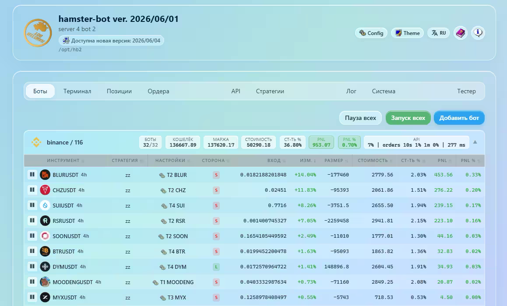
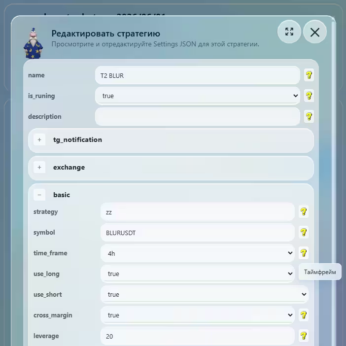
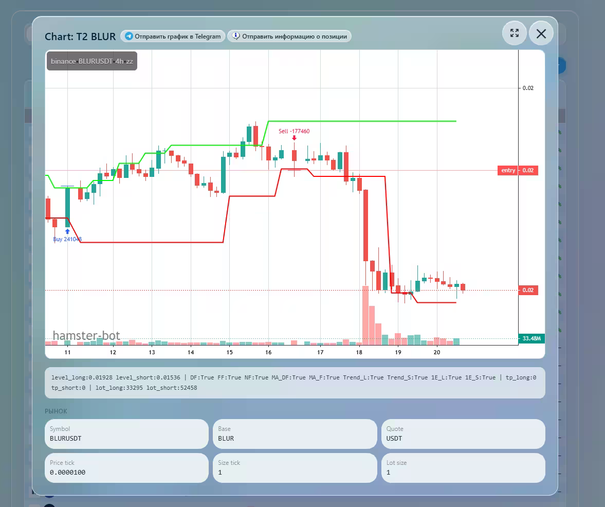
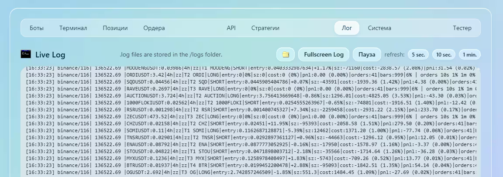

<div align="center">


# hamster-bot

**Торговый бот для криптобирж · алготрейдинг · достоверный портфельный бэктест**

На рынке с 2018 года. Бесплатный. Работает на вашем компьютере или сервере.

[](https://hamster-bot.com/ru/bot)
[](https://t.me/bothamster)
[](https://www.youtube.com/@hamster-bot)


[О боте](#о-боте) · [Биржи](#поддерживаемые-биржи) · [Скачать](#скачать-и-установить) · [Скриншоты](#скриншоты) · [Контакты](#контакты) · [Возможности](#возможности) · [Бэктестер](#бэктестер-hamster-bottester) · [Видео](#видео) · [API и MCP](#api-и-mcp)

</div>

---

## О боте

**hamster-bot** автоматизирует торговлю по стратегиям на криптобиржах и позволяет построить собственную торговую систему из множества алгоритмов.

- **Self-hosted** — бот запускается на вашем сервере или ПК. API-ключи и данные не покидают вашу машину.
- **Кроссплатформенный** — нативные сборки для Windows, Linux и macOS, один исполняемый файл без зависимостей.
- **20+ стратегий** — трендовые, контртрендовые, пробойные, возврат к среднему, сигналы TradingView.
- **Встроенный тиковый портфельный бэктестер** с оптимизатором параметров, тепловыми картами и 3D Surface.
- **WEB-интерфейс, HTTP API и MCP-сервер** — управляйте ботом из браузера, скриптов или ИИ-ассистента (Claude и другие MCP-клиенты).
- **Бесплатный.** Либо удобный готовый сервис на ваш выбор.

---

## Поддерживаемые биржи

<table>
  <tr>
    <td align="center" width="25%"><br><a href="https://hamster-bot.com/ru/exchange/bybit"><b>Bybit</b></a></td>
    <td align="center" width="25%"><br><a href="https://hamster-bot.com/ru/exchange/binance"><b>Binance</b></a><br><sub><a href="https://t.me/bothamster/287">API broker</a></sub></td>
    <td align="center" width="25%"><br><a href="https://hamster-bot.com/ru/exchange/okx"><b>OKX</b></a></td>
    <td align="center" width="25%"><br><b>MEXC</b></td>
  </tr>
  <tr>
    <td align="center"><br><a href="https://hamster-bot.com/ru/exchange/bingx"><b>BingX</b></a></td>
    <td align="center"><br><b>BitMEX</b></td>
    <td align="center"><br><b>HTX</b></td>
    <td align="center"><br><b>KuCoin</b></td>
  </tr>
  <tr>
    <td align="center"><br><b>Gate.io</b></td>
    <td align="center"><br><a href="https://hamster-bot.com/ru/exchange/bitget"><b>Bitget</b></a></td>
    <td align="center"><br><b>Phemex</b></td>
    <td align="center"><br><b>WEEX</b></td>
  </tr>
  <tr>
    <td align="center"><br><b>Backpack</b></td>
    <td align="center"><br><a href="https://hamster-bot.com/ru/exchange/btse"><b>BTSE</b></a></td>
    <td align="center"><br><a href="https://hamster-bot.com/ru/exchange/hyperliquid"><b>Hyperliquid</b></a></td>
    <td align="center"><br><b>Tiger</b><br><sub>broker Bybit, Binance</sub></td>
  </tr>
</table>

Подробности по каждой бирже, партнёрские программы и листинги — на странице [hamster-bot.com/ru/exchange](https://hamster-bot.com/ru/exchange). Пожалуйста, используйте реферальные ссылки с сайта при регистрации на бирже — так вы поддерживаете проект.

---

## Скачать и установить

Актуальная версия:

| Платформа | Архив |
|---|---|
| 🪟 **Windows** x64 | [hb.zip](https://github.com/ksandric/hamster-bot/blob/master/hb.zip?raw=true) |
| 🐧 **Linux** x64 | [hb_linux-x64.zip](https://github.com/ksandric/hamster-bot/blob/master/hb_linux-x64.zip?raw=true) |
| 🐧 **Linux** arm64 | [hb_linux-arm64.zip](https://github.com/ksandric/hamster-bot/blob/master/hb_linux-arm64.zip?raw=true) |
| 🍎 **macOS** x64 (Intel) | [hb_osx-x64.zip](https://github.com/ksandric/hamster-bot/blob/master/hb_osx-x64.zip?raw=true) |
| 🍎 **macOS** arm64 (Apple Silicon) | [hb_osx-arm64.zip](https://github.com/ksandric/hamster-bot/blob/master/hb_osx-arm64.zip?raw=true) |

После запуска WEB-интерфейс доступен в браузере по адресу `http://127.0.0.1:<порт>` (локально по умолчанию порт `80`). Дальше добавьте API-ключи биржи и настройте стратегии.

<details>
<summary><b>🐧 Linux (VPS) — установка одной командой</b></summary>

> Рекомендуемые ОС: Ubuntu 20.04 / 22.04 / 24.04. Выбирайте локацию сервера **не в США** — биржи блокируют такие запросы (Europe и Asia — ОК). Для первого VPS подойдёт самый дешёвый тариф.

1. Создайте папку для бота (так можно установить много ботов в разные папки `hb1`, `hb2` …):
   ```bash
   mkdir -p /opt/hb1
   ```
2. Перейдите в неё:
   ```bash
   cd /opt/hb1
   ```
3. Скачайте и запустите скрипт установки (он скачает и распакует архив и создаст `.service` в systemd):
   ```bash
   wget -qO- https://raw.githubusercontent.com/ksandric/hamster-bot/refs/heads/master/install_local.sh | bash
   ```
4. Скрипт запросит порт и проверит, что он свободен. Рекомендуется выбирать порты по порядку, начиная с `81`.

Бот работает как сервис: запускается вместе с сервером и перезапускается при падении.

```bash
journalctl --follow -u hamster-bot_1.service   # лог в реальном времени
systemctl status hamster-bot_1.service         # состояние
systemctl restart hamster-bot_1.service        # перезапуск
systemctl stop hamster-bot_1.service           # остановка
```

**Обновление** бота в текущей папке (позиции и ордера не закрываются):

```bash
cd /opt/hb2
wget -qO- https://raw.githubusercontent.com/ksandric/hamster-bot/refs/heads/master/update_local.sh | bash
```

**Обновить / перезапустить все активные боты на сервере:**

```bash
wget -qO- https://raw.githubusercontent.com/ksandric/hamster-bot/refs/heads/master/update_all.sh | bash
wget -qO- https://raw.githubusercontent.com/ksandric/hamster-bot/refs/heads/master/restart_all.sh | bash
```

Видеоинструкции: [установка на Linux](https://youtu.be/jxb6aZQwtN4), [обновление](https://youtu.be/FJgu7OfgUWU), [аренда VPS](https://www.youtube.com/watch?v=zmiTOxyXWeQ). Полные инструкции — на странице [hamster-bot.com/ru/bot](https://hamster-bot.com/ru/bot).

</details>

<details>
<summary><b>🪟 Windows</b></summary>

Для каждого бота создайте отдельную папку (например `C:\bots\bot_1`). Установить можно двумя способами:

- **Вручную:** скачайте [hb.zip](https://github.com/ksandric/hamster-bot/blob/master/hb.zip?raw=true), распакуйте в папку бота и запустите `hb_c.exe`.
- **Скриптом [manage_local.bat](https://raw.githubusercontent.com/ksandric/hamster-bot/refs/heads/master/manage_local.bat):** положите его в пустую папку бота и запустите двойным кликом. Скрипт запросит права администратора и покажет меню: установка, установка как сервис (автозапуск через планировщик задач, открытие порта в брандмауэре, автоперезапуск), обновление, остановка/запуск, просмотр лога.

Обновить бота можно и кнопкой «Обновить бота» в веб-интерфейсе.

</details>

<details>
<summary><b>🍎 macOS</b></summary>

Скачайте архив [hb_osx-x64.zip](https://github.com/ksandric/hamster-bot/blob/master/hb_osx-x64.zip?raw=true) (или [hb_osx-arm64.zip](https://github.com/ksandric/hamster-bot/blob/master/hb_osx-arm64.zip?raw=true) для Apple Silicon), распакуйте в папку `hb` на рабочем столе и в терминале выполните:

```bash
cd Desktop/hb
chmod a+x hb_c
xattr -dr com.apple.quarantine .   # снять карантин
codesign --force --sign - ./hb_c   # локальная подпись
./hb_c
```

</details>

<details>
<summary><b>🔔 WatchDog — уведомление, если бот офлайн</b></summary>

Независимый внешний сервис следит, что бот жив. Если бот перестал выходить на связь, вы получите в Telegram сообщение `WARNING! Bot is offline.` Настраивается в `settings_program.json`: `"watchdog": true/false` и `"watchdog_timer_minutes"` (рекомендуется 60).

</details>

---

## Скриншоты

<table>
  <tr>
    <td width="50%"><br><sub><b>Вкладка с ботами</b></sub></td>
    <td width="50%"><br><sub><b>Настройка стратегии</b></sub></td>
  </tr>
  <tr>
    <td width="50%"><br><sub><b>Просмотр графика</b></sub></td>
    <td width="50%"><br><sub><b>Лог</b></sub></td>
  </tr>
</table>

---

## Контакты

| | |
|---|---|
| 👤 **Разработчик** — вопросы, разработка, общение | [@dreamcast2](https://t.me/dreamcast2) |
| 📢 **Telegram-канал** — новости и обновления | [@bothamster](https://t.me/bothamster) |
| 💬 **Telegram-чат** — общение с пользователями | [@bitmextrue](https://t.me/bitmextrue) |
| 💬 **Telegram EN chat** | [@hamster_EN](https://t.me/hamster_EN) |
| ▶️ **YouTube** — видео о боте и стратегиях | [@hamster-bot](https://www.youtube.com/@hamster-bot) |
| 🌐 **Сайт** | [hamster-bot.com](https://hamster-bot.com/ru/bot) |

Проект можно поддержать донатом — реквизиты на странице [hamster-bot.com/ru/contact](https://hamster-bot.com/ru/contact).

---

## Возможности

### Управление ботом

Управлять ботом можно через **WEB-интерфейс**, **HTTP API**, **MCP** (из ИИ-ассистента) и просто редактируя текстовые конфиги `.json`.

- **WEB-интерфейс** — мониторинг и управление из любого браузера по IP-адресу вашего сервера. Позиции, баланс и настройки обновляются в реальном времени без перезагрузки страницы.
- **Консольный интерфейс** с режимом dashboard — компактная таблица состояния всех активных ботов (есть и ARM64-сборка).
- **Уведомления в Telegram** — открытие и закрытие сделок картинкой графика, алерты при критических событиях. Отдельный чат для каждой стратегии.
- **Торговля по алертам TradingView** через Webhook URL — автоматическое открытие и закрытие позиций по сигналам.
- **Обновление без остановки торговли** — кнопкой в интерфейсе; открытые позиции и ордера не закрываются.

### Производительность

Оптимизировано для одновременной работы множества аккаунтов и вариантов настроек в одном боте. Стабильность проверена на **2000+ ботов в одном процессе**. Бот с пятью стратегиями на трёх аккаунтах потребляет всего **~70 МБ памяти**.

### Управление капиталом и риск-менеджмент

- Размер лота: фиксированный (в монетах или USDT) или процент от баланса.
- Закрывающие опции: Take Profit, Stop Loss, Trailing Stop, закрытие по сигналам индикаторов ТА, по времени, по марже аккаунта, безубыток, пауза после убытка или прибыли.
- Take Profit по балансу маржи (по эквити).
- Автоматический перевод прибыли с торгового счёта на счёт финансирования.

### Торговые стратегии

Множество стратегий, из которых можно составить уникальный портфель; возможна авторебалансировка — стратегии делятся профитом и убытком между собой.

| Тип | Стратегии |
|---|---|
| **Трендовые / пробойные** | [ZigZag (ZZ, ZZ-2, ZZ-6)](https://hamster-bot.com/ru/algo/zigzag), [ZigZag Double](https://hamster-bot.com/ru/algo/zigzag-double), [Donchian Channel](https://hamster-bot.com/ru/algo/donchianchannel), [Channel Close Strategy](https://hamster-bot.com/ru/algo/tv-ccs), [RiskTurtle](https://hamster-bot.com/ru/algo/riskturtle), [Moving Average Crossover](https://hamster-bot.com/ru/algo/movingaveragecrossover), [Squeeze](https://hamster-bot.com/ru/algo/squeeze), [RSI Pullback](https://hamster-bot.com/ru/algo/rsipullback), [DoubleDragon](https://hamster-bot.com/ru/algo/doubledragon) |
| **Контртрендовые / возврат к среднему** | [MRS](https://hamster-bot.com/ru/algo/mrs), [MRS2](https://hamster-bot.com/ru/algo/mrs2), [MRS3](https://hamster-bot.com/ru/algo/mrs3), [HiDeep](https://hamster-bot.com/ru/algo/hideep), [RedFlag](https://hamster-bot.com/ru/algo/redflag), [SmartProfit](https://hamster-bot.com/ru/algo/smartprofit), [ShadowOverlap](https://hamster-bot.com/ru/algo/shadowoverlap), [TV MAPM](https://hamster-bot.com/ru/algo/tv-mapm), [MZ](https://hamster-bot.com/ru/algo/mz) |
| **Сигналы TradingView** | [TradingView Alerts / Webhook](https://hamster-bot.com/ru/algo) |
| **Прочее** | [Volume Market](https://hamster-bot.com/ru/algo/volumemarket) (набор торгового объёма), [Close Position Delete Orders](https://hamster-bot.com/ru/algo/closepositiondeleteorders) |

📖 [Описание всех стратегий →](https://hamster-bot.com/ru/algo)

**Нужна своя стратегия?** Любую идею или Pine Script стратегию можно добавить в hamster-bot — оставьте заявку через [форму](https://forms.gle/RLVqNCjg4dtosqmF6) или напишите [разработчику](https://t.me/dreamcast2). Это полноценная реализация с управлением ордерами и позицией в реальном времени, а не торговля по алертам.

### Готовое решение

**Не хотите настраивать всё самостоятельно?** Команда hamster-bot предоставляет проверенные пресеты стратегий: подключаете пресет — бот сразу торгует по готовой конфигурации. [Готовое решение для инвесторов →](https://hamster-bot.com/ru/phoenix)

---

## Бэктестер hamster-bot/tester

> **Достоверный портфельный бэктест. Уровень quant-исследований.**
> Тестер встроен в бота — отдельно ставить ничего не нужно.

**Особенности:**

- **Портфельный тест.** Несколько стратегий разных типов на разных парах и таймфреймах — на одном общем балансе: суммарная загрузка депозита, общая просадка, перекрытие позиций.
- **Тот же продакшн-код.** Бэктест прогоняет тот же код, на котором бот торгует в реальном времени: стратегии, сервис позиций, лимитер позиций, опции аккаунта. Никакого переписывания логики под тестер.
- **Честная симуляция внутри свечи.** Стратегия вызывается по каждому изменению формирующейся свечи — трейлинги, перестановки ордеров и выходы внутри свечи работают как на реальных торгах.
- **Реалистичные издержки.** Комиссии мейкера/тейкера, проскальзывание и задержка маркет- и стоп-ордеров, фандинг, ограничение исполнения лимиток объёмом свечи.
- **Данные скачиваются автоматически.** Bybit, Binance, MEXC, BitMEX — за любой исторический период; можно подключить свои данные в CSV.
- **Подробный интерактивный HTML-отчёт.** Кривая эквити, тепловая карта доходности по месяцам, графики сделок по каждой паре и 50+ метрик: Sharpe, Sortino, Calmar, CAGR, Recovery Factor, серии побед/поражений, загрузка депозита и др.
- **Проверка на подгонку.** Монте-Карло по сделкам, PnL без лучших сделок и без лучшей пары, топ-5 просадок, MAE/MFE каждой сделки, результат по часам, дням недели и режимам рынка, расстояние до ликвидации.
- **Оптимизатор параметров.** Перебор любых настроек бота, стратегий, аккаунта и самого тестера. Параллельные прогоны на всех ядрах, Monte Carlo выборка для огромных пространств параметров, подбор портфеля пар без повторов. Результаты — в сводной таблице, на тепловых картах и 3D Surface.
- **Проверка устойчивости.** Walk-forward, карта плато параметров, стресс-тест в один клик, сравнение прогонов, результат по режимам рынка (рост, падение, флэт, волатильность).
- **Любая сложная логика.** Тестер реализован как коннектор к «виртуальной бирже» (mock-объект): бот думает, что торгует на реальной бирже, а виртуальная биржа всё считает и строит отчёт. Тестер не отправляет ордера и не требует API-ключей.

**Быстрый старт:**

1. Положите `.json`-настройки стратегий в `tester/settings_strategy` (или создайте их во вкладке **Тестер → Параметры**).
2. Задайте период, баланс и комиссии в `config_tester.json`:
   ```json
   {
     "name_comment": "first_test",
     "InitialBalance": 1000.0,
     "StartDate": "2026-01-01T00:00:00",
     "EndDate": "2026-03-01T00:00:00",
     "WarmupDays": 30,
     "MakerFee": 0.00036,
     "TakerFee": 0.001,
     "UpdateData": true,
     "parameter_mining": []
   }
   ```
3. Запустите тест во вкладке **Тестер** веб-интерфейса («Мастер тестера») или из консоли:
   ```bash
   ./hb_c --run-tester                                        # Linux / macOS
   hb_c.exe --run-tester                                      # Windows (или manage_tester.bat)
   ./hb_c --run-report-optimizer tester/report/first_test     # пересобрать отчёт оптимизатора
   ```
4. Откройте HTML-отчёт из `tester/report/first_test`.

📖 [Полное описание тестера →](https://hamster-bot.com/ru/tester) · 🎬 [Видеоуроки по тестеру](#видео) · Программный доступ к тестеру — см. [API](#api-и-mcp).

---

## Видео

<table>
  <tr>
    <td align="center" width="33%"><a href="https://youtu.be/C5v2Zm_2jPg"></a><br><sub>Claude с MCP в hamster-bot: подключение и примеры</sub></td>
    <td align="center" width="33%"><a href="https://youtu.be/hHa0eE0yTw4"></a><br><sub>Первый запуск торгового бота</sub></td>
    <td align="center" width="33%"><a href="https://youtu.be/DlngicoNcbw"></a><br><sub>[1/4] Тестер торговых стратегий</sub></td>
  </tr>
  <tr>
    <td align="center"><a href="https://youtu.be/_bCpws3F-SE"></a><br><sub>[2/4] Портфельный бэктест. Оптимизатор</sub></td>
    <td align="center"><a href="https://youtu.be/52gtXYhO6ho"></a><br><sub>[3/4] Перебор и анализ. Тепловые карты</sub></td>
    <td align="center"><a href="https://youtu.be/fMWA-8PiP8U"></a><br><sub>[4/4] Инструкция по тестам. Перебор пар</sub></td>
  </tr>
  <tr>
    <td align="center"><a href="https://youtu.be/3DPradsg_Bw"></a><br><sub>Тестер. Три сценария тестирования</sub></td>
    <td align="center"><a href="https://youtu.be/rMcIBo88r1s"></a><br><sub>Тестер. Новый веб-интерфейс</sub></td>
    <td align="center"><a href="https://youtu.be/JhdUpbJne0I"></a><br><sub>Перебор параметров в бэктесте</sub></td>
  </tr>
  <tr>
    <td align="center"><a href="https://youtu.be/UAu5TM0dFtI"></a><br><sub>Отличие между стратегиями MRS 1, 2, 3</sub></td>
    <td align="center"><a href="https://youtu.be/ChXYYcDp2Nk"></a><br><sub>Кто такой dreamcast2</sub></td>
    <td align="center"><a href="https://youtu.be/cCvdnAOJl7k"></a><br><sub>Торговля по алертам TradingView (Webhook URL)</sub></td>
  </tr>
</table>

**Ещё видео:**

- [Обзор бота. Скачивание и первый запуск на Windows](https://youtu.be/ADfdh_iZUzE)
- [Установка и запуск бота на Linux-сервере](https://youtu.be/jxb6aZQwtN4) · [Обновление бота на Linux](https://youtu.be/FJgu7OfgUWU) · [Запуск на Linux-сервере](https://youtu.be/YVgCUQ3GBEk)
- [Dashboard-режим консольного интерфейса](https://youtu.be/QUrjHn81xj8) · [Web-интерфейс (инструкция)](https://youtu.be/PZZsaVI8psc) · [Упрощённый режим настроек](https://youtu.be/tQ7TIpom3HM)
- [Настройка закрывающих опций: Take-Profit, Stop-Loss, Trailing Stop](https://youtu.be/6-oZ-Ub5uto)
- [Поддержка OKX и переработанный watchdog](https://youtu.be/DrXzbYX25g8)

Все видео — на [YouTube-канале @hamster-bot](https://www.youtube.com/@hamster-bot) и на странице [hamster-bot.com/ru/video](https://hamster-bot.com/ru/video).

---

## API и MCP

Бот управляется по **HTTP API** (настройки, стратегии, ключи бирж, позиции и ордера, логи, тестер) и через встроенный **MCP-сервер**: подключите Claude или другой MCP-клиент, и ассистент сам посмотрит состояние ботов, изменит стратегии и проведёт исследование в тестере. Видео: [Claude с MCP в hamster-bot](https://youtu.be/C5v2Zm_2jPg).

> Документация ниже встроена из [API.md](API.md) автоматически — GitHub Action [build-pages](.github/workflows/build-pages.yml) обновляет её при изменении `API.md`. Локально: `python scripts/sync_readme_api.py`.

<!-- API:START -->
<!-- Содержимое между маркерами генерируется из API.md (scripts/sync_readme_api.py). Правьте API.md, а не этот блок. -->

HTTP API для управления ботом и тестером: настройки, стратегии, API-ключи бирж, позиции и ордера, логи, запуск тестера и работа с его отчётами.

Адрес — тот же, что у веб-интерфейса: `http://<хост>:<порт>`, порт задаётся полем `port` в `settings_program.json`.

---

### Содержание

[Доступ](#доступ) · [Запросы и ответы](#запросы-и-ответы) · [Настройки](#настройки) · [Стратегии](#стратегии) · [Аккаунты](#аккаунты) · [Боты](#боты) · [Позиции и ордера](#позиции-и-ордера) · [Система и логи](#система-и-логи) · [Тестер](#тестер) · [MCP для ИИ-ассистентов](#mcp-для-ии-ассистентов) · [Коды ответов](#коды-ответов)

---

### Доступ

**Токен API (рекомендуется).** Передавайте в каждом запросе заголовок `Authorization: Bearer <api_token>`:

```bash
curl -H "Authorization: Bearer <api_token>" http://127.0.0.1:5000/api/current/bots
```

`api_token` бот создаёт сам при первом запуске и хранит в `settings_program.json`. Токен работает с любого адреса и при любом значении `auth_telegram`, и вход из браузера его не сбрасывает. Храните токен как пароль: с ним доступно всё, включая торговлю и ключи бирж.

Посмотреть и скопировать токен можно в веб-интерфейсе: «Глобальная конфигурация», блок «Токен API и MCP». Там же кнопка «Выпустить новый»; прежний токен сразу перестаёт действовать. При выключенном входе через Telegram этот блок работает только с этой же машины (`127.0.0.1`). В редакторе конфига, в логе и в ответе `GET /api/settings/config` токен скрыт (видны последние 4 символа), а через редактор и `POST /api/settings/config` его изменить нельзя.

Новый токен через API: `POST /api/settings/api-token/regenerate`, ответ `{ "success": true, "api_token": "..." }`.

**Без токена, с той же машины.** Если вход через Telegram выключен (`"auth_telegram": false`), запросы без токена принимаются только с этой же машины по адресу `127.0.0.1` или `localhost`:

```bash
curl http://127.0.0.1:5000/api/current/bots
```

С других адресов без токена API отвечает `401`. Веб-интерфейс при выключенном входе по-прежнему открыт любому, кто может подключиться к порту, поэтому на сервере с открытым портом оставляйте вход включённым.

**Запросы со страниц других сайтов** (`POST` с заголовком `Origin`, не совпадающим с адресом бота) отклоняются с кодом `403` — это защита от CSRF. curl, скрипты и MCP-клиенты заголовок `Origin` не отправляют, их это не касается. Если бот стоит за обратным прокси, прокси должен передавать исходный заголовок `Host`.

**Cookie входа.** Вместо токена можно передавать cookie `hamster-bot-token`, если вход через Telegram включён:

1. `POST /htmx/login/get-token` — бот присылает одноразовый код в Telegram.
2. `POST /htmx/login/verify` с формой `token_enter=<код>` — в ответе приходит заголовок `Set-Cookie: hamster-bot-token=...`.
3. Передавайте cookie в запросах: `curl -b "hamster-bot-token=<значение>" ...`

Cookie действует до 10 дней. Действует только последний вход: новый вход (в том числе из браузера) делает прежний cookie недействительным.

---

### Запросы и ответы

- Тело POST-запросов — JSON в кодировке UTF-8 (`Content-Type: application/json`).
- Имена в пути URL-кодируются: стратегия `T4 BTC` → `/api/settings/strategy/T4%20BTC`.
- Настройки и конфиги передаются и возвращаются в том же виде, что и в JSON-файлах бота.
- Успешное действие возвращает `{ "success": true, ... }`.
- Ошибка возвращает `{ "success": false, "error": "текст ошибки" }` с кодом из таблицы [Коды ответов](#коды-ответов).
- Бот определяется аккаунтом и именем стратегии: `/{accountName}/{settingsName}`. Если стратегия торгует несколькими парами, нужную пару выбирает параметр `?symbol=`. Без него берётся первая.

---

### Настройки

#### GET /api/settings/config
Глобальный конфиг программы (`settings_program.json`). Токен Telegram-бота замаскирован: видны первые 4 символа. `api_token` замаскирован: видны последние 4 символа.

**Ответ 200:**
```json
{
  "name": "MyBot",
  "use_web": true,
  "port": 5000,
  "api_token": "••••••••••••b9c2",
  "telegram": {
    "bot_token": "1234************",
    "id_chat": 123456789
  }
}
```

**Ошибки:** `503` — конфиг ещё не загружен

---

#### POST /api/settings/config
Изменяет глобальный конфиг и сразу применяет его. Передавайте только поля, которые меняются, — остальные останутся как были. Токен Telegram-бота, `api_token` и `tester_data_dir` здесь не меняются: эти поля в теле игнорируются.

**Запрос:**
```json
{ "name": "MyBot", "chart": { "count": 500 } }
```

**Ответ 200:** `{ "success": true }`

**Ошибки:** `400` — пустое тело или неверный JSON, `500` — не удалось сохранить

---

#### POST /api/settings/api-token/regenerate
Выпускает новый `api_token`; прежний сразу перестаёт действовать. Это единственный ответ API, в котором токен виден целиком. Тело не нужно.

**Ответ 200:** `{ "success": true, "api_token": "<новый токен>" }`

**Ошибки:** `500` — не удалось сохранить

---

#### GET /api/settings/hints/{kind}
Описания полей настроек — те же подсказки, что показывает редактор настроек. `{kind}`:
- `settings` — настройки стратегий (бота и тестера), для всех стратегий сразу;
- `config_tester` — конфиг тестера, включая `parameter_mining`, `walk_forward` и столбцы `reports_history.csv`;
- `settings_program` — глобальный конфиг.

Параметры:
- `?lang=` — `en` (по умолчанию), `ru` или `pt`;
- `?filter=` — только поля, в пути которых есть одна из подстрок через запятую, например `?filter=zigzag,close_by_margin`.

**Ответ 200:** объект «путь поля через точку → описание»:
```json
{
  "parameter_mining": "List of parameters to mine. Each has a name (parameter path) and either a start/end/step range or a values list...",
  "monte_carlo": "Mining limit: if there are more combinations than this number, a random sample of this size is used..."
}
```

**Ошибки:** `404` — неизвестный `{kind}`

---

#### GET /api/settings/schema
Какие поля настроек на что-то влияют. `?strategy=` — код стратегии (`basic.strategy`); без него — карта по всем стратегиям.

**Ответ 200** (`?strategy=zz`, сокращённо):
```json
{
  "strategy": "zz", "type": "trend",
  "sections": ["zz"],
  "ignored_sections": ["hd", "zigzag", "mrs2", "..."],
  "position_filter": true, "supported_in_tester": true,
  "conditional_fields": [
    { "fields": ["zz.depth", "zz.detection", "zz.open", "..."], "active_when": "zz.type = ZZ2" },
    { "fields": ["zz.zz6_*"], "active_when": "zz.type = ZZ6" },
    { "fields": ["zz.ma_filter"], "active_when": "zz.use_ma_filter = true" },
    { "fields": ["basic.balance_percentage_long", "basic.risk_long"], "active_when": "basic.use_long = true and basic.lot_long = 0" }
  ],
  "notes": { "zz.zz6_risk_max": "ZZ6 only caps the lot multiplier ..." },
  "tester_ignores": { "basic.leverage": "the tester does not model leverage ..." },
  "shared_fields": ["zz.from_level_price"]
}
```

- `sections` — секции, которые читает стратегия; секции из `ignored_sections` она не читает. Общие секции (`basic`, `options`, `filter`, `exchange`) в списках не указаны.
- `position_filter` — стратегия учитывает `filter`; поля `filter.<имя>.*` действуют, только когда `filter.<имя>.use = true`.
- `conditional_fields` — поля, которые действуют только при условии. `*` в конце — все поля с этим началом.
- `notes` — поля, которые влияют на результат только в крайних случаях (перебор по ним часто даёт одинаковые строки).
- `tester_ignores` — поля, которых тестер не моделирует.
- `shared_fields` — поля секции, которые читают и другие стратегии.

Поле без правила считается действующим. Те же правила дают предупреждения `warnings` при сохранении настроек и запуске тестера.

**Ошибки:** `404` — неизвестная стратегия

---

### Стратегии

#### GET /api/settings/strategy
Все стратегии бота.

**Ответ 200:**
```json
[
  {
    "name": "T4 BTC",
    "is_runing": true,
    "exchange": { "name": "binance", "account": "main" },
    "basic": { "symbol": "BTCUSDT", "strategy": "zigzag", "time_frame": "1h" }
  }
]
```

---

#### GET /api/settings/strategy/{name}
Одна стратегия по имени (без учёта регистра).

**Ошибки:** `404` — не найдена

---

#### POST /api/settings/strategy/draft
Черновик стратегии со значениями по умолчанию для выбранного аккаунта. Ничего не сохраняет: поправьте результат и отправьте в `POST /api/settings/strategy`.

**Запрос:**
```json
{ "account": "main", "symbol": "BTCUSDT", "strategy": "zigzag", "time_frame": "1h", "account_type": "UNIFIED" }
```

Вместо `symbol` можно передать `symbols: ["BTCUSDT", "ETHUSDT"]` — стратегия на несколько пар. `time_frame` (по умолчанию `1h`) и `account_type` необязательны.

**Ответ 200:** объект стратегии

**Ошибки:** `400` — не указаны стратегия или пара, `404` — аккаунт не найден

---

#### POST /api/settings/strategy
Создаёт или изменяет стратегию. Тело — объект стратегии, как в `GET /api/settings/strategy/{name}`. Изменения сразу применяются к работающим ботам, новая стратегия сразу запускается.

`?old_name=` — переименовать стратегию `old_name` в имя из тела.

**Запрос:** `POST /api/settings/strategy?old_name=T4%20BTC`

**Ответ 200:**
```json
{ "success": true, "name": "T4 BTC v2", "created": false, "warnings": null }
```

`created: true` — стратегия новая. `warnings` — изменённые поля, которые стратегия не читает (см. [`/api/settings/schema`](#get-apisettingsschema)); `null` — замечаний нет.

**Ошибки:** `400` — не заполнены `name`, `exchange.name`, `exchange.account` или `basic.strategy` либо имя содержит недопустимые символы, `500` — не удалось сохранить

---

#### POST /api/settings/strategy/{name}/copy
Копирует стратегию под новым именем, сохраняет и запускает копию.

**Запрос:**
```json
{ "new_name": "T4 ETH", "new_symbol": "ETHUSDT" }
```

`new_symbol` необязателен: без него пара остаётся как у исходной стратегии.

**Ответ 200:** `{ "success": true, "name": "T4 ETH" }`

**Ошибки:** `404` — исходная стратегия не найдена, `409` — стратегия с таким именем уже есть

---

#### POST /api/settings/strategy/from-tester
Создаёт стратегию бота из проверенной настройки тестера. Настройка копируется как есть; `exchange.name` и `exchange.account` берутся от аккаунта. По умолчанию стратегия создаётся **на паузе** (`is_runing: false`): бот её загружает, но не торгует, пока её не запустят ([`play`](#post-apibotsaccountnamesettingsnameplay)).

**Запрос:**
```json
{ "folder": "lut_now", "name": "T_BTC", "account": "demo_bybit", "new_name": "T_BTC live", "start": false }
```

- `folder` — папка настроек тестера, см. [Папка настроек в запросе](#папка-настроек-в-запросе);
- `new_name` — имя стратегии; без него — как у настройки;
- `start: true` — сразу запустить торговлю.

**Ответ 200:**
```json
{ "success": true, "name": "T_BTC live", "account": "demo_bybit", "exchange": "bybit", "is_runing": false, "warnings": null }
```

`warnings` — как у [сохранения стратегии](#post-apisettingsstrategy), плюс предупреждение, если настройку проверяли на другой бирже, чем у аккаунта.

**Ошибки:** `404` — настройка тестера или аккаунт не найдены, `409` — стратегия с таким именем уже есть, `500` — не удалось сохранить

---

#### POST /api/settings/strategy/{name}/delete
Удаляет стратегию и останавливает её ботов. Ордера и позиция на бирже при этом не трогаются.

`?full=1` — полное удаление: стратегия ставится на паузу, все её ордера отменяются, позиция закрывается, и только потом стратегия удаляется. Если отменить ордера или закрыть позицию не удалось, стратегия остаётся на паузе и **не** удаляется — позиция не останется без управления.

**Как правильно отключить стратегию.** Позиция и ордера на паузе остаются на бирже без управления стратегией (её стопов, тейков и выходов), поэтому их нельзя бросать. Порядок:
1. пауза;
2. снять ордера;
3. закрыть позицию;
4. удалить настройку.

`?full=1` делает именно это: после паузы ждёт завершения текущего цикла бота, чтобы он не успел выставить новый ордер. Вручную — тот же порядок, и паузу пропускать нельзя: работающий бот выставит ордера заново сразу после отмены.

**Запрос:** `POST /api/settings/strategy/T4%20BTC/delete?full=1`

**Ответ 200:** `{ "success": true }`

**Ошибки:** `404` — не найдена, `409` — для `full=1` стратегия должна быть запущена, `500` — не удалось отменить ордера, закрыть позицию или удалить стратегию

---

### Аккаунты

Аккаунт — это API-ключ биржи, от имени которого торгуют стратегии.

#### GET /api/settings/accounts
Все аккаунты.

**Ответ 200:**
```json
[
  {
    "name": "main",
    "exchange": "binance",
    "api_key": "...",
    "api_secret": "...",
    "is_encrypted": true
  }
]
```

---

#### GET /api/settings/accounts/{name}
Один аккаунт по имени (без учёта регистра).

**Ошибки:** `404` — не найден

---

#### GET /api/settings/accounts/{name}/symbols
Пары, доступные на бирже для этого аккаунта.

**Ответ 200:**
```json
["BTCUSDT", "ETHUSDT"]
```

**Ошибки:** `404` — аккаунт не найден

---

#### POST /api/settings/accounts
Создаёт или изменяет аккаунт. Изменения сразу применяются к работающим ботам.

`?old_name=` — переименовать аккаунт `old_name` в имя из тела.

Ключи передаются открытым текстом. При `"is_encrypted": true` бот хранит их зашифрованными. Пустые `api_key`, `api_secret`, `api_passphrase` при изменении оставляют текущие значения, в том числе при смене `is_encrypted` (ключи перешифровываются в файле). Аккаунт заменяется целиком: поля, которых нет в теле, сбрасываются (`open_positions_limiter` → 0, `url_settings`, `telegram_id`); не переданный `close_by_margin` остаётся прежним.

**Запрос:**
```json
{ "name": "main", "exchange": "binance", "api_key": "...", "api_secret": "...", "is_encrypted": true, "open_positions_limiter": 0 }
```

**Ответ 200:**
```json
{ "success": true, "name": "main", "applied": 3 }
```

`applied` — сколько работающих ботов получили новый ключ.

**Ошибки:** `400` — не указаны `name` или `exchange`, недопустимое имя, `500` — не удалось сохранить

---

#### POST /api/settings/accounts/{name}/delete
Удаляет аккаунт.

**Ответ 200:** `{ "success": true }`

**Ошибки:** `404` — не найден, `500` — не удалось удалить

---

#### GET /api/current/accounts/{name}/info
Данные аккаунта и ключа с биржи (обновляются раз в час). Нужен хотя бы один запущенный бот на этом аккаунте.

**Ответ 200:**
```json
{
  "name": "main",
  "exchange": "binance",
  "api_key": "abc1****",
  "account_type": "UNIFIED",
  "symbol": "BTCUSDT",
  "ok": true,
  "status": "OK",
  "warnings": [],
  "rows": [ { "name": "Permissions", "value": "..." } ],
  "updated_utc": "2026-10-25T12:00:00Z"
}
```

**Ошибки:** `404` — аккаунт не найден, `409` — на аккаунте нет запущенного бота

---

#### GET /api/current/accounts/{name}/balance-history
История баланса аккаунта. `?max=` — не больше стольких точек (по умолчанию 5000).

**Ответ 200:**
```json
{
  "account": "main",
  "total": 12000,
  "points": [ { "time": 1761393600, "margin": 1234.5, "wallet": 1200.0, "positions": "..." } ]
}
```

`time` — Unix-время в секундах, `total` — сколько точек всего в истории.

---

#### POST /api/current/accounts/{name}/balance-history/compact
Сжимает историю баланса сейчас по настройкам `monitoring` (обычно это происходит автоматически).

**Ответ 200:**
```json
{ "success": true, "message": "...", "points_before": 12000, "points_after": 3000, "bytes_before": 512000, "bytes_after": 128000 }
```

---

### Боты

Бот — это запущенная стратегия на конкретной паре.

#### GET /api/current/bots
Сводка по всем ботам.

**Ответ 200:**
```json
[
  {
    "account": "main",
    "exchange": "binance",
    "strategy": "T4 BTC",
    "strategy_code": "zigzag",
    "symbol": "BTCUSDT",
    "time_frame": "1h",
    "is_runing": true,
    "is_live": true,
    "status_text": "...",
    "last_price": 65500.0,
    "last_bar_time": "2026-10-25T12:00:00",
    "last_sync_utc": "2026-10-25T12:00:05Z",
    "sync_missed_cycles": 0,
    "position": { "side": "Buy", "size": 0.01, "entry_price": 65000.0, "cost": 650.0, "unrealized_pnl": 5.0 },
    "orders": 2
  }
]
```

`is_runing: false` — бот на паузе. `position: null` — позиции нет. `orders` — число открытых ордеров. `sync_missed_cycles` — сколько циклов подряд не удалось получить данные с биржи.

---

#### GET /api/current/balances
Баланс кошелька и маржи по каждому API-ключу, отдельно для спота и фьючерсов. `?account=` — только этот аккаунт.

**Запрос:** `GET /api/current/balances?account=main`

**Ответ 200:**
```json
[
  { "account": "main", "exchange": "bybit", "type": "futures", "wallet": 1234.56, "margin": 1180.20 },
  { "account": "main", "exchange": "bybit", "type": "spot", "wallet": 500.00, "margin": 500.00 }
]
```

`wallet` — баланс кошелька, `margin` — маржинальный баланс, как их отдаёт биржа. Для спота оба значения — баланс в USDT. Баланс берётся у запущенных ботов: аккаунт без запущенного бота в список не попадает.

---

#### GET /api/current/bots/{accountName}/{settingsName}/bars
Свечи бота. `?limit=` — последние N свечей (по умолчанию 500).

**Запрос:** `GET /api/current/bots/main/T4%20BTC/bars?limit=100`

**Ответ 200:** массив свечей с полями `Timestamp`, `Open`, `High`, `Low`, `Close`, `Volume` и др.

**Ошибки:** `404` — бот не найден

---

#### GET /api/current/ubots
Полный снимок состояния всех ботов. Набор полей подробный и может меняться между версиями — для постоянной интеграции используйте `GET /api/current/bots`, `/api/current/positions` и `/api/current/orders`.

---

#### GET /api/current/ubots/{accountName}/{settingsName}
Полный снимок состояния одного бота (см. оговорку выше).

**Ошибки:** `404` — бот не найден

---

#### POST /api/bots/pause-all
Ставит на паузу всех ботов.

**Ответ 200:**
```json
{ "success": true, "count": 5 }
```

---

#### POST /api/bots/play-all
Запускает всех ботов.

**Ответ 200:**
```json
{ "success": true, "count": 5 }
```

---

#### POST /api/bots/{accountName}/{settingsName}/pause
Ставит стратегию на паузу (для стратегии на несколько пар — все её пары): она перестаёт выставлять ордера. Открытая позиция и ордера остаются на бирже без управления стратегией — после паузы либо снова запустите её, либо снимите ордера и закройте позицию (см. [удаление](#post-apisettingsstrategynamedelete)).

**Запрос:** `POST /api/bots/main/T4%20BTC/pause`

**Ответ 200:**
```json
{ "success": true, "name": "T4 BTC", "is_runing": false }
```

**Ошибки:** `404` — не найдена, `500` — не удалось сохранить

---

#### POST /api/bots/{accountName}/{settingsName}/play
Запускает стратегию, поставленную на паузу.

**Ответ 200:**
```json
{ "success": true, "name": "T4 BTC", "is_runing": true }
```

**Ошибки:** `404` — не найдена, `500` — не удалось сохранить

---

#### POST /api/bots/{accountName}/{settingsName}/send-chart
Отправляет график бота в Telegram.

**Ответ 200:** `{ "success": true }`

**Ошибки:** `404` — бот не найден, `500` — не удалось построить или отправить график

---

#### POST /api/bots/{accountName}/{settingsName}/send-position
Отправляет в Telegram сводку по боту: баланс, позиция, PnL, ордера.

**Ответ 200:** `{ "success": true }`

**Ошибки:** `404` — бот не найден

---

#### POST /api/delete/{accountName}/{settingsName}
Удаляет стратегию бота и убирает бота из работы. Ордера и позиция на бирже **не** снимаются и остаются без управления. Для безопасного отключения используйте [`POST /api/settings/strategy/{name}/delete?full=1`](#post-apisettingsstrategynamedelete).

**Запрос:** `POST /api/delete/main/T4%20BTC`

**Ответ 200:** `{ "success": true }`

**Ошибки:** `404` — бот не найден, `500` — не удалось удалить

---

### Позиции и ордера

#### GET /api/current/positions
Позиции всех ботов.

**Ответ 200:**
```json
[
  {
    "account": "main",
    "exchange": "binance",
    "strategy": "T4 BTC",
    "symbol": "BTCUSDT",
    "position": {
      "Symbol": "BTCUSDT",
      "Side": "Buy",
      "Size": 0.01,
      "EntryPrice": 65000.0,
      "Cost": 650.0,
      "UnrealizedPnl": 12.5,
      "Leverage": 10,
      "Cross": false
    }
  },
  {
    "account": "sub1",
    "exchange": "binance",
    "strategy": "T3 ETH",
    "symbol": "ETHUSDT",
    "position": null
  }
]
```

---

#### GET /api/current/orders
Открытые ордера всех ботов.

**Ответ 200:**
```json
[
  {
    "account": "main",
    "exchange": "binance",
    "strategy": "T4 BTC",
    "symbol": "BTCUSDT",
    "order": {
      "Id": "order-123",
      "client_id": "cl-456",
      "Market": "BTCUSDT",
      "Side": "Buy",
      "Type": "Limit",
      "Status": "New",
      "Size": 0.01,
      "filledSize": 0.0,
      "remainingSize": 0.01,
      "Price": 64000.0,
      "TriggerPrice": null,
      "ReduceOnly": false
    }
  }
]
```

---

#### POST /api/trading/market
Рыночный ордер на аккаунте. Пара должна торговаться одним из ботов этого аккаунта.

**Запрос:**
```json
{ "account": "main", "symbol": "BTCUSDT", "side": "Buy", "size": 0.01 }
```

`side` — `Buy` или `Sell`; `size` — объём в единицах биржи для этой пары.

**Ответ 200:**
```json
{ "success": true, "order_id": "order-123" }
```

**Ошибки:** `400` — неверные `side` или `size`, `404` — на аккаунте нет бота с этой парой, `500` — биржа не приняла ордер

---

#### POST /api/positions/{accountName}/{settingsName}/close
Закрывает позицию бота.

**Запрос:** `POST /api/positions/main/T4%20BTC/close`

**Ответ 200:** `{ "success": true }`

**Ошибки:** `404` — бот не найден

---

#### POST /api/positions/{accountName}/close-all
Закрывает все открытые позиции аккаунта.

**Ответ 200:**
```json
{ "success": true, "count": 3 }
```

`count` — сколько позиций отправлено на закрытие.

---

#### POST /api/positions/{accountName}/reduce
Сокращает все открытые позиции аккаунта на заданный процент.

**Запрос:**
```json
{ "percent": 50 }
```

`percent` — от 1 до 100.

**Ответ 200:**
```json
{ "success": true, "count": 3 }
```

---

#### POST /api/orders/{accountName}/{settingsName}/{orderId}/cancel
Отменяет один ордер бота (обычный или стоп-ордер).

**Запрос:** `POST /api/orders/main/T4%20BTC/order-123/cancel`

**Ответ 200:** `{ "success": true }`

**Ошибки:** `404` — ордер не найден, `500` — биржа не отменила ордер

---

#### POST /api/orders/{accountName}/cancel-all
Отменяет все ордера аккаунта.

**Ответ 200:**
```json
{ "success": true, "count": 2 }
```

`count` — у скольких ботов отменены ордера.

---

#### POST /api/orders/cancel-all
Отменяет все ордера на всех аккаунтах.

**Ответ 200:**
```json
{ "success": true, "count": 7 }
```

---

### Система и логи

#### GET /api/system/status
Версия программы, ресурсы сервера и счётчики. Поля `pid`, `exe_path`, `working_directory`, `port` (порт, на который пришёл запрос) и `started_utc` однозначно определяют экземпляр процесса: по ним внешний скрипт отличает несколько запущенных ботов и замечает перезапуск (меняются `pid` и `started_utc`).

**Ответ 200:**
```json
{
  "program": "hamster-bot",
  "version": "2026/10/23",
  "name": "MyBot",
  "type": "bot",
  "os": "Linux 6.1",
  "architecture": "X64",
  "machine": "srv1",
  "runtime": ".NET 10.0",
  "processors": 4,
  "pid": 12345,
  "exe_path": "/opt/hamster-bot/hb_c",
  "working_directory": "/opt/hamster-bot",
  "port": 80,
  "started_utc": "2026-10-24T08:00:00Z",
  "uptime_sec": 86400,
  "cpu_percent": 12.5,
  "memory_total_bytes": 8589934592,
  "memory_available_bytes": 4294967296,
  "process_memory_bytes": 314572800,
  "disk": "/",
  "disk_total_bytes": 107374182400,
  "disk_free_bytes": 53687091200,
  "accounts": 2,
  "strategies": 5,
  "bots": 6,
  "bots_running": 5,
  "auto_update_supported": true
}
```

---

#### POST /api/system/shutdown
Завершает программу. Доступно только при входе через Telegram. Сама программа не запустится: перезапуск процесса делает внешний супервизор (служба, systemd, скрипт). Проверить, что супервизор поднимает бота через 61 секунду после остановки (`RestartSec=61`, `run_service.cmd`), можно скриптом `tools/check-shutdown-restart.ps1` (останавливает работающий бот). Инструмента `restart_program` нет. Он обычно и не нужен: изменения стратегий, аккаунтов и настроек через API применяются к работающим ботам сразу. Обновление с перезапуском — `POST /api/system/update`. После перезапуска убедитесь по `pid` и `started_utc` из `/api/system/status`, что поднялся новый процесс. Перед остановкой проверьте, что нет прогона тестера: он прервётся, а очередь не сохраняется.

**Ответ 200:** `{ "success": true }` — программа завершится через полсекунды

**Ошибки:** `409` — вход через Telegram не настроен

---

#### POST /api/system/update
Запускает обновление программы.

**Ответ 200:** `{ "success": true }`

**Ошибки:** `409` — автообновление на этой системе не поддерживается (см. `auto_update_supported` в `/api/system/status`), `500` — обновление не запустилось

---

#### GET /api/logs
Последние строки общего лога. `?tail=` — сколько последних строк (по умолчанию все доступные).

**Ответ 200:** массив строк

---

#### GET /api/logs/errors
Ошибки за последние `?hours=` часов (по умолчанию 24, не больше 48). `?warnings=1` — вместе с предупреждениями. Если Telegram не настроен (`telegram.id_chat` = 0), сообщения не отправляются и ошибок «chat not found» нет: в лог один раз за запуск пишется предупреждение `Telegram chat is not set`. Ошибка «chat not found» при заданном чате означает неверный id чата или токен. Повторы уже сгруппированы: одинаковые сообщения одного источника объединены в одну запись, `count` — сколько раз повторилось за всё хранимое окно (до 48 часов, с запуска программы), `first_utc` и `last_utc` — первое и последнее появление. Записи идут от свежих к старым.

`?since=` — время UTC (например `2026-11-02T06:00:00Z`; без часового пояса считается UTC): вернутся только записи, повторявшиеся после него. Для проверки «что нового с прошлого раза» передайте самый поздний `last_utc` из предыдущего ответа. Если `first_utc` записи раньше `since`, это старая ошибка, которая случилась снова, а `count` остаётся общим. Неверная дата — `400`.

**Ответ 200:**
```json
[
  {
    "level": "Error",
    "first_utc": "2026-10-25T08:00:00Z",
    "last_utc": "2026-10-25T12:00:00Z",
    "count": 3,
    "source": "T4 BTC",
    "message": "...",
    "exception": "..."
  }
]
```

---

#### GET /api/logs/files
Файлы логов, свежие первыми; каждый день — новый файл. `?contains=` — только файлы, в имени которых есть текст (имя стратегии, аккаунта, пара).

Виды логов:
- лог стратегии — `log_<дата>_<Биржа> <аккаунт>  <пара> <таймфрейм> <стратегия> <имя>.log`, по одному на бота: сигналы, ордера, исполнения, позиция, ошибки стратегии;
- лог аккаунта — `log_<аккаунт>_<дата>.log`: балансы и позиции с биржи, ответы и ошибки API биржи, лимитер позиций, `close_by_margin`;
- общий лог программы — `log_<дата>.log` ([`/api/logs`](#get-apilogs));
- логи тестера — `TESTER_*.log`.

Формат даты в именах разный, поэтому файл удобнее искать через `contains`.

**Ответ 200:**
```json
[ { "name": "log_25-10-2026.log", "size": 102400, "modified_utc": "2026-10-25T12:00:00Z" } ]
```

---

#### GET /api/logs/files/{filename}
Содержимое файла лога как текст. `?download=1` — скачать файлом.

**Ошибки:** `400` — недопустимое имя файла, `404` — файл не найден

---

### Тестер

Тестер прогоняет стратегии на исторических данных. Перебор параметров, стресс-тест и повтор по snapshot выполняются по одному. Одиночные прогоны можно запускать параллельно. Пока загружаются исторические данные, тестер не запускается, и наоборот — в этих случаях ответ `409`.

Все запуски работают в фоне: ответ приходит сразу, ход и результат — в `GET /api/tester/status`.

#### GET /api/tester/status
Состояние тестера.

**Ответ 200:**
```json
{
  "run": {
    "active": true,
    "status": "Running",
    "started_utc": "2026-10-25T12:00:00Z",
    "finished_utc": null,
    "message": "API mining run",
    "runs_done": 40,
    "runs_total": 120,
    "current_bar": 5000,
    "total_bars": 20000,
    "parallel": false,
    "report_folders": ["T4"],
    "result_files": ["T4/reports_history.csv", "T4/report_optimizer_T4_auto_x_auto_y_20261025_120000.html", "T4/run_snapshot_T4_20261025_115500.json"]
  },
  "wizard_runs": [
    {
      "run_id": "a1b2c3d4",
      "strategies": ["T4 BTC"],
      "status": "Completed",
      "started_utc": "2026-10-25T11:00:00Z",
      "finished_utc": "2026-10-25T11:02:00Z",
      "current_bar": 20000,
      "total_bars": 20000,
      "message": "Completed: 1 strategies.",
      "report_path": "T4/T4_run_001_of_001_BTCUSDT_1h_ee8c3c2e.html",
      "report_json_path": null,
      "snapshot_path": "T4/run_snapshot_T4_20261025_110000.json",
      "stats": null,
      "warnings": []
    }
  ],
  "download": { "active": false, "status": "Idle", "started_utc": null, "finished_utc": null, "message": "", "result": null },
  "settings_folder": ""
}
```

- `run` — перебор параметров, стресс-тест или повтор по snapshot. `status`: `Idle`, `Running`, `Completed` или `Failed`; `runs_done` / `runs_total` — сколько комбинаций параметров посчитано. `report_folders` — папки результатов текущего или последнего прогона внутри `root=report`; `result_files` — итоговые файлы, уже записанные в них с начала прогона: `reports_history.csv`, сводный HTML (`report_optimizer_*`, `stress_test_*`, `walk_forward_*`) и snapshot.
- `queue` — запуски полного режима, ждущие своей очереди (`?queue=1`): `queue_id`, `position`, `message`, `queued_utc`.
- `wizard_runs` — одиночные прогоны. Завершённые видны ещё час. Метрики (`stats`) здесь не передаются — они в [`/api/tester/wizard-runs/{run_id}`](#get-apitesterwizard-runsrun_id). У прогонов пакета, ещё не начатых, `status: "Queued"`.
- `batches` — пакеты одиночных прогонов: `batch_id`, `done` из `total`.
- `download` — загрузка исторических данных.
- `settings_folder` — текущая папка настроек тестера.

---

#### GET /api/tester/config
Конфиг тестера (`config_tester.json`): период, комиссии, параметры перебора и т. д.

---

#### POST /api/tester/config
Сохраняет конфиг тестера. Тело — конфиг целиком, как в `GET /api/tester/config`.

**Ответ 200:** `{ "success": true }`

**Ошибки:** `400` — пустое тело или неверный JSON, `500` — не удалось сохранить

---

#### GET /api/tester/data-coverage
Какие исторические данные уже скачаны: `?exchange=` (обязательно), `?symbols=A,B` (без него — все скачанные пары биржи), `?start=&end=` — период для проверки.

**Ответ 200:**
```json
[
  {
    "symbol": "ADAUSDT", "downloaded": true, "first_day": "2026-04-09", "last_day": "2026-09-15",
    "days": 67, "gap_days": 93, "size_mb": 1.78,
    "period": { "covered": false, "missing_days": 132, "missing_first": ["2026-03-01", "2026-03-02", "2026-03-03"], "missing_last": "2026-08-30" }
  },
  { "symbol": "NOPEUSDT", "downloaded": false }
]
```

`gap_days` — дни без данных между первым и последним. `period` есть только при `start` и `end`. Учитываются только скачанные файлы: недостающее докачивает сам прогон (`UpdateData`) или [`download-data`](#post-apitesterdownload-data).

**Ошибки:** `400` — биржа не поддерживается или задан только один из `start` / `end`

---

#### GET /api/tester/exchanges
Биржи, для которых тестер умеет загружать исторические данные.

**Ответ 200:** `["bybit", "binance", ...]`

Откуда берутся минутные свечи:

| Биржа | Источник |
|-------|----------|
| `bybit` | архивы сделок public.bybit.com, свечи собираются из сделок |
| `binance`, `binance-spot` | архивы минутных свечей data.binance.vision: закрытый месяц — одним архивом, текущий — по дням |
| `okx`, `bitget-futures`, `bitget-spot`, `kucoin-futures`, `kucoin`, `bingx` (USDT-M), `phemex` (спот), `btse`, `weex-futures`, `backpack` | REST API биржи, вся история |
| `gate.io-spot` | REST API, минутные свечи только за последние ~7 дней |

Свечи из REST API проверяются по часовым свечам той же биржи: сумма объёма минуток каждого часа должна совпасть с объёмом часа, иначе час запрашивается заново. Сегодняшний день не скачивается — только закрытые дни. Дни, за которые у источника данных нет (пара ещё не торговалась, биржа не хранит так далеко), записываются в `_no_data_days.json` папки пары и повторно не запрашиваются; чтобы перепроверить их, файл можно удалить.

---

#### GET /api/tester/exchanges/{exchange}/symbols
Пары биржи. Пустой список — биржа сейчас недоступна; пару можно указать вручную.

**Ошибки:** `404` — тестер не поддерживает эту биржу

---

#### Папка настроек в запросе

Все запросы к настройкам тестера, запуски и загрузка данных принимают папку настроек: `?folder=` в адресе или поле `folder` в теле запуска. Это путь внутри `tester/settings_strategy`, `""` — основная папка. Без `folder` используется папка, выбранная в интерфейсе ([`POST /api/tester/settings-folder`](#post-apitestersettings-folder)). Это общее состояние: его может сменить пользователь или параллельная задача, поэтому скриптам и ассистентам лучше всегда передавать `folder`.

Несуществующая папка — ошибка `404`. Создать папку — [`POST /api/tester/settings-folders`](#post-apitestersettings-folders).

У настройки могут быть необязательные поля `tags` (список меток) и `owner` (автор, например `"MCP"`). По ним настройки отбираются в списке и удаляются разом.

---

#### GET /api/tester/settings
Настройки стратегий тестера в папке. Параметры:
- `?folder=` — папка;
- `?mask=` — только имена по маске (`*` — любые символы, `?` — один символ);
- `?tag=`, `?owner=` — только с этой меткой или этим автором;
- `?full=1` — настройки целиком вместо краткой формы: выгрузка папки, которую восстанавливает [`/api/tester/settings/import`](#post-apitestersettingsimport).

**Ответ 200:**
```json
[ { "name": "T4 BTC", "exchange": "bybit", "symbol": "BTCUSDT", "symbols": null, "strategy": "zigzag", "time_frame": "1h", "tags": ["tmp"], "owner": "MCP" } ]
```

---

#### GET /api/tester/settings/{name}
Настройка тестера целиком. `?folder=` — папка.

**Ошибки:** `404` — не найдена

---

#### POST /api/tester/settings/draft
Черновик настройки тестера со значениями по умолчанию. Ничего не сохраняет.

**Запрос:**
```json
{ "exchange": "bybit", "symbol": "BTCUSDT", "strategy": "zigzag", "time_frame": "1h" }
```

Вместо `symbol` можно передать `symbols` — несколько пар. `account_type` необязателен.

**Ответ 200:** объект настройки

**Ошибки:** `400` — тестер не поддерживает биржу либо не указаны стратегия или пара

---

#### POST /api/tester/settings
Сохраняет настройку тестера. Тело — объект настройки. `?old_name=` — переименовать настройку `old_name`. Существующая настройка с тем же именем не перезаписывается. `?folder=` — папка. `?owner_default=` — значение `owner`, если в настройке его нет (MCP передаёт `MCP`).

**Ответ 200:** `{ "success": true, "name": "T4 BTC", "folder": "", "warnings": null }`

`warnings` — изменённые (не как по умолчанию) поля, которые ни на что не влияют: секция другой стратегии (одна строка на секцию), поле другого `zz.type`, выключенный включатель `use_*`, `basic.leverage` (тестер плечо не моделирует) — см. [`/api/settings/schema`](#get-apisettingsschema). `null` — замечаний нет. Сохранение предупреждения не отменяют.

То же поле `warnings` есть в ответе копирования настройки, а у импорта — `warnings` по имени каждой настройки.

**Ошибки:** `400` — не заполнены обязательные поля, `409` — настройка с таким именем уже есть, `500` — не удалось сохранить

---

#### POST /api/tester/settings/{name}/copy
Копирует настройку тестера в той же папке (`?folder=`), при желании — на другую биржу или пару. `?owner_default=` — как у сохранения. Скопировать в другую папку — [`copy-to-folder`](#post-apitestersettingscopy-to-folder).

**Запрос:**
```json
{ "new_name": "T4 BTC binance", "new_exchange": "binance", "new_symbol": "" }
```

Пустые `new_exchange` и `new_symbol` оставляют значения исходной настройки.

**Ответ 200:** `{ "success": true, "name": "T4 BTC binance" }`

**Ошибки:** `404` — исходная настройка не найдена, `409` — имя занято

---

#### POST /api/tester/settings/{name}/delete
Удаляет настройку тестера. `?folder=` — папка. Удалить много настроек разом — [`delete-matching`](#post-apitestersettingsdelete-matching).

**Ответ 200:** `{ "success": true }`

**Ошибки:** `404` — не найдена

---

#### GET /api/tester/settings-folder
Текущая папка настроек тестера и её вложенные папки. Папки позволяют держать несколько наборов настроек; `""` — основная папка.

**Ответ 200:**
```json
{ "path": "", "folders": [ { "name": "2026-10", "settings": 12 } ] }
```

`settings` — сколько настроек в папке.

---

#### POST /api/tester/settings-folder
Выбирает папку настроек тестера для интерфейса и для запросов без `folder`.

**Запрос:**
```json
{ "path": "2026-10" }
```

**Ответ 200:** `{ "success": true, "path": "2026-10" }`

**Ошибки:** `404` — папка не найдена

---

#### POST /api/tester/settings-folders
Создаёт папку настроек, вложенные тоже. Выбранную папку не меняет.

**Запрос:**
```json
{ "path": "research/zz_hedge" }
```

**Ответ 200:** `{ "success": true, "path": "research/zz_hedge", "created": true }`

`created: false` — папка уже была.

**Ошибки:** `400` — пустой путь, `..` или недопустимые символы в имени

---

#### POST /api/tester/settings-folders/delete
Удаляет папку настроек со всем содержимым. Основную папку удалить нельзя. Если удалена выбранная папка, выбранной становится основная.

**Запрос:** `{ "path": "research/zz_hedge" }`

**Ответ 200:** `{ "success": true, "deleted_settings": 12 }`

**Ошибки:** `404` — папка не найдена или это основная папка

---

#### POST /api/tester/settings/copy-to-folder
Копирует настройки из одной папки в другую.

**Запрос:**
```json
{ "from": "mrs-bybit", "to": "lut_now", "names": ["C_MU", "T_*"], "on_conflict": "replace" }
```

Какие настройки копировать — `names` (имена или маски), `mask` (`"*"` — все), `tag`, `owner`; фильтры сочетаются, нужен хотя бы один. `on_conflict` — что делать, если имя в папке назначения уже есть: `skip` (по умолчанию), `replace` или `error` (ничего не копировать).

**Ответ 200:** `{ "success": true, "copied": ["C_MU"], "replaced": ["T_BTC"], "skipped": [] }`

**Ошибки:** `400` — нет фильтра, имя без маски не найдено, папки совпадают или конфликт при `on_conflict: "error"`, `404` — папка не найдена

---

#### POST /api/tester/settings/delete-matching
Удаляет настройки папки по фильтру.

**Запрос:**
```json
{ "folder": "lut_now", "owner": "MCP", "tag": "tmp" }
```

Фильтры — как у [`copy-to-folder`](#post-apitestersettingscopy-to-folder), нужен хотя бы один.

**Ответ 200:** `{ "success": true, "folder": "lut_now", "deleted": ["MCP_LZ1"], "not_found": [] }`

**Ошибки:** `400` — нет фильтра, `404` — папка не найдена

---

#### POST /api/tester/settings/import
Сохраняет набор настроек в папку, например выгрузку `GET /api/tester/settings?full=1`.

**Запрос:**
```json
{ "folder": "lut_now", "settings": [ { ... }, { ... } ], "on_conflict": "skip", "owner_default": "MCP" }
```

**Ответ 200:** `{ "success": true, "folder": "lut_now", "saved": ["T_BTC"], "skipped": [], "warnings": { "T_BTC": ["..."] } }`

**Ошибки:** `400` — неверная настройка или конфликт при `on_conflict: "error"`, `404` — папка не найдена

---

#### GET /api/tester/settings-check
Проверка настроек папки без запуска — те же замечания, что `warnings` при [сохранении](#post-apitestersettings). `?folder=` — папка, `?mask=` — имя или маска (по умолчанию все).

**Ответ 200:**
```json
{
  "folder": "lut_now", "total": 125, "with_warnings": 2,
  "settings": [
    { "name": "T_BTW", "strategy": "zz", "warnings": [
      "zz.zz6_len = 8 is ignored: only when zz.type = ZZ6 (now: zz.type = \"ZZ2\")"
    ] }
  ]
}
```

В `settings` — только настройки с замечаниями.

**Ошибки:** `404` — папка не найдена

---

#### POST /api/tester/run
Перебор параметров стратегий (раздел `parameter_mining` конфига тестера).

**Запрос:**
```json
{
  "settings": ["*"],
  "folder": "lut_now",
  "config": { ... },
  "overrides": [
    { "match": "T_*", "mul": { "basic.balance_percentage_long": 2 } },
    { "match": "C_MU", "set": { "basic.use_short": false } },
    { "match": "L_X", "exclude": true }
  ]
}
```

- `settings` — имена настроек или маски (`"*"` — все настройки папки). Имя без маски, которого нет в папке, — ошибка.
- `folder` — папка настроек, см. [Папка настроек в запросе](#папка-настроек-в-запросе).
- `config` необязателен: без него используется сохранённый конфиг тестера.
- `overrides` — правки настроек только на этот запуск; файлы настроек не меняются. Правила применяются по порядку. `match` — имя или маска (по умолчанию все), `tag` — только настройки с этим тегом. `set` заменяет значения, `mul` умножает числа (целое поле остаётся целым), `cap_pct` после них ограничивает `basic.balance_percentage_long` и `_short` этих настроек — множитель размера с потолком на пару: `{ "match": "T_*", "mul": { "basic.balance_percentage_long": 2, "basic.balance_percentage_short": 2 }, "cap_pct": 10 }`. `exclude: true` убирает настройки из запуска. Поля — пути через точку, как в объекте настройки. Если поля нет ни в одной подходящей настройке, это ошибка (обычно опечатка); если его нет только у части, эти настройки перечислены в `not_applied`. Правки записываются в `comment` прогона и попадают в отчёт и snapshot.

**Ответ 200:**
```json
{
  "success": true,
  "folder": "lut_now",
  "strategies": ["C_MU", "T_BTC"],
  "applied": [ { "name": "T_BTC", "changes": ["basic.balance_percentage_long: 10.0 → 20.0"], "not_applied": [] } ],
  "excluded": ["L_X"]
}
```

**Что можно перебирать.** Любую настройку бота (`settings[*].zz.depth`, `settings[T_*].basic.use_short`, `settings[NAME].…`), любое поле конфига тестера (`config_tester.…`), `settings_program.…` и аккаунта. Для чисел достаточно `start`/`end`/`step`, для остальных (текст, логические) задаётся `values`.

**Скрининг пар.** Файл настроек на каждую пару не нужен: берётся одна настройка-шаблон, а символ перебирается как обычный параметр. Список пар — из `tester_exchange_symbols`:

```json
"parameter_mining": [
  {
    "name": "settings[*].basic.symbol",
    "start": 1.0, "end": 1.0, "step": 1.0,
    "values": ["1000BONKUSDT", "1000PEPEUSDT", "AAVEUSDT", "ADAUSDT"]
  }
]
```

Вместе с другими параметрами (например, `settings[*].zz.depth`) получается сетка на каждую пару. Символ попадает в столбец `reports_history.csv`, так что сводку «пара → медиана по сетке» считают по этому файлу (`read_tester_file` с `columns`). Данные для всех перебираемых пар скачивает `tester_download_data`. Число комбинаций равно произведению длин списков значений: ограничивайте его `monte_carlo`.

Тестер прогоняет все комбинации значений из `parameter_mining`; если задан `monte_carlo`, то случайную выборку такого размера. Заранее проверяйте число комбинаций; остановить запущенный перебор — [`POST /api/tester/stop`](#post-apitesterstop) с `full: true`. Ход — в `run` ответа `GET /api/tester/status` (`runs_done` из `runs_total`).

Результаты попадают в папку `report` с именем, равным `name_comment` конфига тестера (недопустимые в имени файла символы заменяются на `_`). Ответ на запуск возвращает её в `report_folders`; при включённом `walk_forward` там же вторая папка `<name_comment>_WF_OOS` с прогонами вне выборки. Чтобы эксперименты не смешивались, давайте каждому свой `name_comment`. В папке:
- `reports_history.csv` — по строке на комбинацию: метрики (`TotalPnLPercent`, `MaxDrawdownPercent`, `ProfitFactor`, `WinRate`, `TradingVolume`, …), `Strategies` (имена настроек прогона через `|`), `RunTag` и столбец со значением каждого перебираемого параметра. При `single_mode` в каждой строке одна настройка, блоки комбинаций идут по имени настройки;
- HTML-отчёт каждой комбинации (если включён `report.enable_html_report`) и его [JSON-версия](#get-apitesterreportsjson) (если включён `report.enable_json_report`); `RunTag` комбинации есть в имени файла;
- сводный отчёт оптимизатора `report_optimizer_*.html`;
- `run_snapshot_<name_comment>_<время>.json` — точные настройки и конфиг запуска, см. [`snapshot-run`](#post-apitestersnapshot-run).

`periods` — перебор на нескольких периодах: `[["2026-02-01","2026-05-01"], ["2026-05-01","2026-08-01"]]`. Каждый период — отдельный полный прогон в папку `<name_comment>_<начало>_<конец>`; они идут друг за другом через очередь. Ответ — `{ "success": true, "periods": [ { "start", "end", "report_folders", "queued", "queue_id", "position" } ], ... }`. Сравнить периоды — [`/api/tester/mining-robustness`](#get-apitestermining-robustness).

**Предупреждения запуска.** Ответ на запуск содержит `warnings` (`null` — замечаний нет):
- параметр `parameter_mining`, которого нет ни в настройках, ни в конфигах (опечатка: он не применится);
- перебираемое поле, которое подходящие настройки не читают (`ignored by all N matching settings`: все комбинации дадут одинаковый результат) или читают не все; условия по полям, которые сами перебираются, не проверяются;
- заметка о поле, которое влияет только в крайних случаях (`zz.zz6_risk_max`);
- поле из `overrides`, которое настройка не читает.

Предупреждения запуск не отменяют.

Одиночные прогоны и пакеты пишут эти предупреждения и в итоги прогона (`warnings` у [`wizard-runs/{run_id}`](#get-apitesterwizard-runsrun_id)), пакет — ещё и в общий `warnings` с префиксом `runs[i] <имя>`. Запуск по snapshot проверяется так же.

**Портфельный перебор.** Без `single_mode` все настройки идут вместе в каждой комбинации. Параметр с именем `settings[ИМЯ].путь` меняет одну настройку, а `settings[T_*].путь` — все настройки по маске имени; остальной набор остаётся как есть. Сравнивайте строки по портфельным `MaxDrawdownPercent` и `UlcerIndex` (включите `reports_history.ulcer_index`).

`sides` — стороны торговли на этот запуск: `long` (только лонг), `short` (только шорт), `split` (каждая настройка дважды — `<имя> [long]` и `<имя> [short]`; при `single_mode` стороны майнятся отдельно) или `both` (как в настройках).

`?queue=1` — если тестер занят другим полным прогоном или загрузкой данных, запуск встаёт в очередь, а не получает `409`. Ответ тогда — `{ "success": true, "queued": true, "queue_id": "63a8e791", "position": 1, ... }`; запуск начнётся сам, очередь видна в `queue` ответа `GET /api/tester/status`, отменить ещё не начатый — [`POST /api/tester/queue/{queue_id}/cancel`](#post-apitesterqueuequeue_idcancel).

**Ошибки:** `400` — настройка не найдена, неверный `config`, `overrides` или `sides`, `404` — папка не найдена, `409` — тестер уже работает или загружаются данные (без `?queue=1`)

---

#### POST /api/tester/stress
Стресс-тест: те же настройки в ухудшенных условиях исполнения. Тело, `?queue=1` и ответы — как у `/api/tester/run`, кроме `periods` (не поддерживается). Результаты — в папке `<name_comment>_STRESS` (`report_folders` ответа): строки сценариев в `reports_history.csv` и сравнение с базой в `stress_test_*.html`.

---

#### POST /api/tester/queue/{queue_id}/cancel
Убирает из очереди полный запуск, который ещё не начался.

**Ответ 200:** `{ "success": true }`

**Ошибки:** `404` — запуск уже начался, отменён или `queue_id` неверный

---

#### POST /api/tester/wizard-run
Одиночный прогон стратегий. Тело — как у `/api/tester/run`, включая `folder` и `overrides`.

**Ответ 200:**
```json
{ "success": true, "run_id": "a1b2c3d4", "folder": "lut_now", "strategies": ["T4 BTC"], "applied": [], "excluded": [] }
```

Дождаться прогона и получить его метрики и пути к отчётам — [`GET /api/tester/wizard-runs/{run_id}?wait=`](#get-apitesterwizard-runsrun_id). Ход всех прогонов — в `wizard_runs` ответа `GET /api/tester/status`.

**Ошибки:** `400` — не найдено ни одной из настроек, `409` — загружаются данные

---

#### POST /api/tester/wizard-batch
Пакет одиночных прогонов: несколько наборов, каждый на нескольких периодах, через одну очередь с ограничением параллельности. Так сравнивают варианты и проверяют вариант на нескольких периодах одним запросом.

**Запрос:**
```json
{
  "folder": "lut_now",
  "config": { ... },
  "periods": [["2026-02-01", "2026-05-01"], ["2026-05-01", "2026-08-01"]],
  "parallel": 2,
  "runs": [
    { "name": "base", "settings": ["*"] },
    { "name": "T x2", "settings": ["*"], "overrides": [ { "match": "T_*", "mul": { "basic.balance_percentage_long": 2 } } ] },
    { "name": "long only", "settings": ["*"], "sides": "long" }
  ]
}
```

Поля набора — как в теле [`/api/tester/run`](#post-apitesterrun) (`settings`, `folder`, `config`, `overrides`, `sides`) плюс `name` и свои `periods`. Чего нет в наборе, берётся из пакета. Каждый набор идёт на каждом периоде отдельным прогоном; без `periods` — на периоде конфига. `parallel` — сколько прогонов одновременно (по умолчанию 2; каждый держит свои данные в памяти). Ошибка в любом наборе отклоняет весь пакет.

**Ответ 200:** то же, что [`GET /api/tester/wizard-batches/{batch_id}`](#get-apitesterwizard-batchesbatch_id), сразу после постановки в очередь.

**Ошибки:** `400` — пустой `runs`, неверные `periods` или ошибка набора (`runs[1]: ...`), `404` — папка не найдена, `409` — загружаются данные

---

#### GET /api/tester/wizard-batches/{batch_id}
Пакет и итоги каждого прогона. `?wait=` — сколько секунд (до 240) ждать завершения всего пакета.

Длинный пакет (десятки прогонов) в полном виде не помещается в ответ (MCP режет его на 200 000 символов, и JSON становится невалидным), поэтому есть сокращение и страницы. Те же параметры у [`POST /api/tester/wizard-batch`](#post-apitesterwizard-batch):

| Параметр | Описание |
|---|---|
| `compact=1` | у каждого прогона только `name`, `start`, `end`, `run_id`, `status`, `run_params`, `key` и пути отчёта (`message` только у упавших). Без `summary`, `stats`, `warnings`, `applied` |
| `offset`, `limit` | страница списка `runs`; `limit=0` — только счётчики. В ответе `offset`, `returned` и `has_more` (есть следующая страница: `offset + returned`). `done`, `total`, `failed` всегда по всему пакету |

Если полный ответ длиннее 150 000 символов, он заменяется компактным автоматически (`compact: true` в ответе); страницы `offset`/`limit` при этом сохраняются.

`key` есть в каждом прогоне, в том числе в полном ответе: главные метрики в одном виде, из `summary` JSON-отчёта, а если отчёта нет, из итоговых `stats`: `pnl`, `pnl_percent`, `max_drawdown_percent`, `max_drawdown_worst_percent` (только при JSON-отчёте), `trades`, `volume`, `fees`, `profit_factor` (только при JSON-отчёте). Вызывать [`reports/json`](#get-apitesterreportsjson) на каждый прогон ради них не нужно.

**Ответ 200:**
```json
{
  "batch_id": "31dd7d67", "status": "Completed", "done": 2, "total": 2, "failed": 0, "parallel": 2,
  "started_utc": "2026-10-27T21:31:27Z",
  "compact": false, "offset": 0, "returned": 2, "has_more": false,
  "runs": [
    {
      "name": "T x2", "start": "2026-02-01", "end": "2026-05-01", "run_id": "a99984a8", "status": "Completed",
      "message": "Completed: 12 strategies.",
      "key": { "pnl": 1240.5, "pnl_percent": 12.4, "max_drawdown_percent": 5.2, "max_drawdown_worst_percent": 8.1, "trades": 140, "volume": 520000.0, "fees": 310.2, "profit_factor": 1.6 },
      "summary": { "pnl_percent": 12.4, "max_drawdown_worst_percent": 8.1, "ulcer_index": 2.3, "profit_factor": 1.6, "trades": 140, "monthly": { "2026-02": 3.1 } },
      "stats": null,
      "report_path": "...html", "report_json_path": "...json", "snapshot_path": "...json",
      "warnings": [],
      "applied": [ { "name": "T_BTC", "changes": ["basic.balance_percentage_long: 10.0 → 20.0"], "not_applied": [] } ],
      "excluded": null
    }
  ]
}
```

`summary` — как раздел `summary` [JSON-отчёта](#get-apitesterreportsjson); он есть, если включён `report.enable_json_report`, иначе вместо него `stats`. Строки прогонов пакета попадают и в `reports_history.csv` папки `name_comment` (столбцы `StartDate`, `EndDate`, `Strategies`). Пакеты хранятся час.

**Ошибки:** `404` — пакета нет: неверный `batch_id`, прошло больше часа или программа перезапускалась

---

#### POST /api/tester/stop
Останавливает прогоны тестера.

**Запрос** (нужно хотя бы одно поле):
```json
{ "run_id": "a1b2c3d4", "batch_id": "5e6f7a8b", "full": true, "clear_queue": true }
```

- `run_id` — одиночный прогон ([`wizard-run`](#post-apitesterwizard-run));
- `batch_id` — все прогоны [пакета](#post-apitesterwizard-batch): ещё не начатые не стартуют;
- `full: true` — текущий полный прогон: перебор, стресс-тест, walk-forward, snapshot;
- `clear_queue: true` — ещё и убрать из [очереди](#post-apitesterqueuequeue_idcancel) не начатые полные прогоны.

Идущий прогон останавливается на следующей свече. Прерванный прогон не пишет ни отчёт, ни строку `reports_history`: результат за часть периода ввёл бы в заблуждение. У полного прогона строки уже посчитанных комбинаций остаются; в параллельном режиме дочерние процессы завершаются. Статусы: полный прогон — `Stopped` в `run` ответа [`/api/tester/status`](#get-apitesterstatus), одиночный — `Cancelled` в [`wizard-runs/{run_id}`](#get-apitesterwizard-runsrun_id). Загрузку исторических данных этот запрос не останавливает.

**Ответ 200:**
```json
{ "success": true, "cancelled_runs": ["a1b2c3d4"], "full_run_stopping": true, "cleared_queue": ["63a8e791"], "note": "Stopping: ..." }
```

**Ошибки:** `400` — не передано ни одного поля, `404` — прогон или пакет не найден

---

#### GET /api/tester/wizard-runs/{run_id}
Одиночный прогон по `run_id`. `?wait=` — сколько секунд (до 240) ждать завершения; без него ответ сразу.

**Ответ 200:**
```json
{
  "run_id": "a82c93c5",
  "strategies": ["T4 BTC", "T4 TSLA"],
  "status": "Completed",
  "started_utc": "2026-10-25T05:26:43Z",
  "finished_utc": "2026-10-25T05:26:50Z",
  "current_bar": 27360,
  "total_bars": 27360,
  "message": "Completed: 2 strategies. 1 warnings.",
  "report_path": "T4/T4_run_001_of_001_system_2_ee8c3c2e.html",
  "report_json_path": "T4/T4_run_001_of_001_system_2_ee8c3c2e.json",
  "snapshot_path": "T4/run_snapshot_T4_20261025_082643.json",
  "stats": { "InitialBalance": 10000.0, "FinalBalance": 9581.25, "TotalPnL": -418.75, "TotalPnLPercent": -4.19, "TotalTrades": 23, "WinRate": 13.04, "MaxDrawdown": 527.89, "MaxDrawdownPercent": 5.26, "TotalFees": 22.2 },
  "warnings": ["T4 TSLA: symbol TSLAUSDT: no data before 2025-09-14 00:00"]
}
```

`status` — `Running`, `Completed` или `Failed`; `Running` после `wait` значит, что время ожидания вышло, — запросите снова. `report_path` и `report_json_path` — пути внутри `root=report`, `null`, если отчёт не записан. `snapshot_path` — snapshot прогона: точные настройки и конфиг, с которыми он шёл. `warnings` — пропущенные настройки, нехватка данных и причина, по которой нет отчёта. Если не запустилась ни одна настройка, прогон завершается со `status: "Failed"` и причиной в `message`. Завершённые прогоны хранятся час (до перезапуска программы).

**Ошибки:** `404` — прогона нет: неверный `run_id`, прошло больше часа или программа перезапускалась

---

#### POST /api/tester/snapshot-run
Повторяет прогон по snapshot-файлу. Каждый запуск сохраняет snapshot рядом с отчётом — `run_snapshot_<name_comment>_<время>.json` с разделами `settings` (настройки всех стратегий), `tester_config` и `program_config`. Токены (`api_token`, `telegram.bot_token`) в snapshot не записываются. Запуск по snapshot — полный режим: один за раз, как перебор. Файл выбирается параметрами `?root=&path=`, как в [файлах тестера](#get-apitesterfiles).

Тело необязательно: можно передать изменённый snapshot — изменения действуют только на этот запуск, файл не меняется. То же в интерфейсе: Тестер, вкладка «Результаты (файлы)», кнопка «Запустить» рядом со snapshot открывает его в редакторе, и правки идут только в этот запуск.

**Запрос:** `POST /api/tester/snapshot-run?root=report&path=T4/run_snapshot_20261025.json`

`?queue=1` — встать в очередь, если тестер занят, как у [`/api/tester/run`](#post-apitesterrun).

**Ответ 200:** `{ "success": true }`

**Ошибки:** `400` — в snapshot нет конфига тестера или настроек, `404` — файл не найден, `409` — тестер уже работает или загружаются данные

---

#### POST /api/tester/download-data
Загружает исторические данные для всех настроек папки (`?folder=`). Ход и итог — в `download` ответа `GET /api/tester/status`.

| Параметр | Описание |
|---|---|
| `start` | Начало периода, например `2026-05-01`. По умолчанию `StartDate` конфига тестера минус `WarmupDays` |
| `end` | Конец периода. По умолчанию текущий момент (UTC). `EndDate` сохранённого конфига не используется, поэтому для докачки свежих дней конфиг менять не нужно |

**Ответ 200:** `{ "success": true }`

После окончания `download.message` кратко пишет, по какой день данные есть на диске, а `download.result` содержит по каждой паре `first_day`, `last_day` (последний день со свечами) и `days`:

```json
"download": {
  "active": false, "status": "Completed", "message": "Data on disk ends at 2026-10-31..2026-10-31 (last day with candles)",
  "result": { "requested_start": null, "requested_end": null,
    "pairs": [ { "symbol": "BTCUSDT", "exchange": "bybit", "first_day": "2025-10-01", "last_day": "2026-10-31", "days": 396 } ] }
}
```

Свечи закрытого дня источник публикует с задержкой (обычно после 06:00 UTC): до этого `last_day` остаётся на день раньше, загрузку нужно повторить позже. Пара без данных получает `first_day`/`last_day` = `null`.

**Ошибки:** `400` — `start` или `end` не дата, либо `start` не раньше `end`; `409` — загрузка уже идёт или работает тестер

---

#### GET /api/tester/wizard-results
Результаты одиночных прогонов, свежие первыми. Новый прогон того же набора настроек заменяет его прежнюю запись; результат конкретного прогона — в [`/api/tester/wizard-runs/{run_id}`](#get-apitesterwizard-runsrun_id).

**Ответ 200:**
```json
[
  {
    "runId": "a82c93c5",
    "timestamp": "2026-10-25T05:26:50Z",
    "strategies": ["T4 BTC"],
    "stats": {
      "InitialBalance": 10000.0, "FinalBalance": 9581.25, "TotalPnL": -418.75, "TotalPnLPercent": -4.19,
      "TotalTrades": 23, "WinRate": 13.04, "MaxDrawdown": 527.89, "MaxDrawdownPercent": 5.26, "TotalFees": 22.2
    },
    "chartUrl": "/tester-report/T4/T4_run_001_of_001_BTCUSDT_1h_ee8c3c2e.html",
    "report_path": "T4/T4_run_001_of_001_BTCUSDT_1h_ee8c3c2e.html",
    "report_json_path": "T4/T4_run_001_of_001_BTCUSDT_1h_ee8c3c2e.json",
    "period": "2025-09-01 .. 2025-09-20",
    "elapsed": "00:00:07"
  }
]
```

`chartUrl` — ссылка на HTML-отчёт для браузера. `report_path` — тот же отчёт как путь внутри `root=report`, для [файлов тестера](#get-apitesterfiles) и [`/api/tester/reports/summary`](#get-apitesterreportssummary). `report_json_path` — его [JSON-версия](#get-apitesterreportsjson); поле есть, только если она записана.

---

#### GET /api/tester/files
Содержимое папки тестера. `?root=` — `report` (отчёты, по умолчанию), `data` (исторические данные: `tester/data` или папка из `tester_data_dir` в `settings_program.json`) или `runs` (наборы для повторных прогонов); `?path=` — путь внутри неё. `?contains=` — только имена с этим текстом, `?offset=` и `?limit=` — часть списка. Сначала идут папки по имени, затем файлы, свежие первыми; `total` — сколько всего элементов подходит.

**Ответ 200:**
```json
{
  "root": "report",
  "path": "T4",
  "total": 2,
  "offset": 0,
  "items": [
    { "name": "old", "is_dir": true, "size": 204800, "modified_utc": "2026-10-20T10:00:00Z", "snapshot": false, "editable": false },
    { "name": "run_snapshot_20261025.json", "is_dir": false, "size": 51200, "modified_utc": "2026-10-25T12:00:00Z", "snapshot": true, "editable": false }
  ]
}
```

`snapshot: true` — файл можно запустить через `/api/tester/snapshot-run`. `editable: true` — файл можно изменить через `/api/tester/files/save`.

**Ошибки:** `404` — папка не найдена

---

#### GET /api/tester/files/download
Скачивает файл (`?root=&path=`). HTML-отчёты открываются в браузере.

**Ошибки:** `404` — файл не найден

---

#### POST /api/tester/files/delete
Удаляет файл или папку (`?root=&path=`).

**Ответ 200:** `{ "success": true }`

**Ошибки:** `400` — недопустимый путь, `404` — не найдено, `409` — работает тестер или загружаются данные

---

#### GET /api/tester/files/content
Содержимое snapshot-файла или JSON-файла из `runs` (`?root=&path=`).

**Ошибки:** `404` — файл не найден или не является snapshot

---

#### POST /api/tester/files/save
Сохраняет JSON-файл в `runs` (`?root=runs&path=`): изменяет существующий или создаёт новый. Тело — новое содержимое файла. Если у существующего файла в теле нет раздела `settings`, он берётся из текущего файла. Новый файл должен быть полным snapshot: непустой `settings` и `tester_config`.

Так готовят прогон для пользователя: в интерфейсе (Тестер, вкладка «Результаты (файлы)», папка `runs`) у каждого такого файла есть кнопки «Запустить» и «Изменить». При `use_runs` в конфиге тестера полный прогон из командной строки (`--run-tester`) запускает все `.json` из `runs`.

**Ответ 200:** `{ "success": true, "created": false }`

**Ошибки:** `400` — пустое тело, неверный JSON или новый файл без `settings` / `tester_config`, `404` — путь не в `runs` или не `.json`

---

#### GET /api/tester/reports/summary
Сводки HTML-отчётов для сравнения прогонов: метрики и кривая доходности. `?r=` — путь отчёта в `report`, параметр можно повторять.

**Запрос:** `GET /api/tester/reports/summary?r=T4/report.html&r=T4_STRESS/report.html`

**Ответ 200:**
```json
[
  {
    "report": "T4/report.html",
    "created": "2026-10-25T12:00:00Z",
    "summary": {
      "name_comment": "T4",
      "start": "2025-01-01T00:00:00",
      "end": "2026-01-01T00:00:00",
      "symbols": ["BTCUSDT"],
      "metrics": { "TotalPnLPercent": 42.1, "MaxDrawdownPercent": 12.3, "ProfitFactor": 1.8, "WinRate": 55.0, "TotalTrades": 120 },
      "equity_t": [1735689600],
      "equity_v": [1000.0]
    }
  }
]
```

`equity_t` и `equity_v` — время (Unix, секунды) и баланс точек кривой доходности. `summary: null` — у отчёта нет сводки.

**Ошибки:** `400` — не передан ни один `r`, `404` — отчёт не найден

---

#### GET /api/tester/reports/json
Подробные результаты одного прогона в компактном JSON. Те же числа, что в HTML-отчёте, но файл в десятки раз меньше: несколько десятков килобайт вместо мегабайтов.

Тестер пишет `<отчёт>.json` рядом с HTML-отчётом, если в конфиге тестера включено `report.enable_json_report` (по умолчанию выключено). JSON пишется и при выключенном `report.enable_html_report`: так большой перебор идёт быстрее и всё равно сохраняет детали каждой комбинации.

Параметры:
- `?path=` — путь отчёта в `report`: файл `.json` или его `.html` (например, `report_path` из [`wizard-results`](#get-apitesterwizard-results));
- `?sections=` — только эти разделы через запятую, например `?sections=summary` или `?sections=metrics,by_symbol`;
- `?trades_offset=` и `?trades_limit=` — часть сделок.

**Разделы:**

| Раздел | Содержимое |
|---|---|
| `summary` | сводка на 1–2 КБ: PnL, просадки (в том числе нереализованная и худшая из трёх, как `MaxDrawdownPercent` в `reports_history.csv`), Ulcer Index, profit factor, Sharpe, CAGR, сделки, win rate, комиссии, средняя и максимальная позиция, худший месяц, доходность по месяцам. Считается при чтении из `run`, `metrics` и `monthly`, поэтому есть и у старых отчётов |
| `run` | `name_comment`, `comment`, `run_tag`, `run_params` (значения перебираемых параметров), период, биржи, стратегии и пары. Что запуск дописал в `comment` текстом (`[overrides: …]`, `[sides: …]`), лежит отдельными полями, разбирать `comment` регуляркой не нужно: `overrides` (массив правил как в запросе, без обрезки, в `comment` он обрезается до 300 символов), `sides`, а также откуда прогон: `batch_id` и `name` (имя набора) для `tester_run_batch` и `tester_run_single` с `periods`, `run_id` для прогонов мастера. Если значения нет, поле `null`. Запуски из интерфейса эти поля не заполняют, повтор по snapshot берёт их из snapshot |
| `metrics` | вся таблица статистики HTML-отчёта по блокам: PnL, баланс, доходность по месяцам, сделки, исполнения, Buy & Hold, риск и экспозиция, Sharpe, Sortino, CAGR, Calmar, Ulcer Index… |
| `by_symbol` | итоги по каждой паре: сделки, win rate, profit factor, PnL, лучшая и худшая сделка, просадка, Buy & Hold, комиссии, объём, размер позиции |
| `monthly` | доходность по месяцам, %: `{ "2025-09": -4.15 }` |
| `trades` | сделки (от открытия позиции до полного закрытия или переворота), отсортированные по времени закрытия, — `columns` и `rows` |
| `curves` | кривые баланса (`equity`) и открытых позиций (`open_positions_total`, `_long`, `_short`), до 500 точек; `t` — Unix-время в секундах, `v` — значения |
| `daily` | значения на конец каждого календарного дня периода, без пропусков: `days`, `equity` (Margin-баланс), `position` (открытая позиция, USDT); `strategies` — стратегии (настройки) с парами, кодом, типом (`trend` / `counter-trend`) и тегами; `pnl` и `position_by_strategy` — по массиву на стратегию в том же порядке: накопленный с начала отчёта вклад в баланс и позиция. Пишется при `report.json_daily` (включено по умолчанию). Для больших наборов раздел большой — сводку по нему даёт [`/api/tester/reports/portfolio`](#get-apitesterreportsportfolio) |
| `settings` | полные настройки стратегий прогона |

Поля `v` (версия формата), `created_utc` и `html_report` (имя HTML-отчёта или `null`) возвращаются всегда.

**Запрос:** `GET /api/tester/reports/json?path=T4/T4_run_001_of_001_BTCUSDT_1h_ee8c3c2e.html&sections=by_symbol,trades&trades_limit=2`

**Ответ 200:**
```json
{
  "v": 1,
  "created_utc": "2026-10-25T05:45:34Z",
  "html_report": "T4_run_001_of_001_BTCUSDT_1h_ee8c3c2e.html",
  "by_symbol": [
    { "symbol": "BTCUSDT", "strategy": "zigzag", "trades": 23, "win_rate": 13.04, "profit_factor": 0.395, "pnl": -390.14,
      "best_trade": 160.02, "worst_trade": -57.7, "max_drawdown_incl_unrealized": -483.2, "buy_hold_percent": 6.81,
      "fee": 22.2, "volume": 221995.16, "position_avg_percent": 49.31, "position_max_percent": 50.72 }
  ],
  "trades": {
    "count": 23,
    "columns": ["symbol", "side", "open", "close", "holding_hours", "fills", "net_pnl", "mae", "mfe"],
    "rows": [
      ["BTCUSDT", "short", "2025-09-01 00:04", "2025-09-01 07:54", 7.83, 2, -57.6968, -57.6968, 38.8311],
      ["BTCUSDT", "long", "2025-09-01 07:54", "2025-09-01 20:45", 12.85, 2, -46.2855, -50.7967, 26.7293]
    ],
    "offset": 0
  }
}
```

В `trades`: `count` — число всех сделок, `net_pnl` — результат сделки за вычетом комиссий, `mae` и `mfe` — худший и лучший промежуточный результат сделки (USDT), время — UTC.

**Ошибки:** `400` — файл не является JSON-отчётом, `404` — JSON-отчёт не найден

---

#### GET /api/tester/reports/portfolio
Портфельная аналитика прогона по разделу `daily` его JSON-отчёта. Стратегии собираются в группы, по группам считается всё, что ниже.

Параметры:
- `?path=` — JSON-отчёт (или его `.html`) в `report`;
- `?group_by=` — `type` (по умолчанию: `T` — трендовые, `CT` — контртрендовые, по коду стратегии), `tag` (первый тег настройки) или `strategy` (каждая настройка — своя группа);
- `?groups={"T":"T_*","CT":"CT_*"}` — группы по маскам имён вместо `group_by`; настройки без совпадения попадают в `other`;
- `?worst_days=` — сколько худших дней каждой группы брать (по умолчанию 10);
- `?curves=0`, `?leave_one_out=0` — не считать эти разделы.

**Ответ 200** (сокращённо):
```json
{
  "start": "2026-08-01", "end": "2026-09-30", "days": 61, "group_by": "type",
  "groups": [ { "group": "T", "strategies": 1, "names": ["T_BTW"], "pnl": -7294.0, "pnl_percent": -72.94, "worst_day": -4838.3, "max_drawdown_usdt": 15259.83, "position_max": 12752.08 } ],
  "correlation": { "CT": { "CT": 1.0, "T": -0.28 }, "T": { "CT": -0.28, "T": 1.0 } },
  "worst_week": { "start": "2026-08-08", "end": "2026-08-14", "pnl": -7200.62, "pnl_percent": -40.19, "by_group": { "CT": 279.98, "T": -7480.6 } },
  "worst_days": { "T": { "days": 5, "pnl": -12902.51, "portfolio_pnl": -12754.28, "others": { "CT": { "pnl": 148.22, "offset_percent": 1.1 } } } },
  "leave_one_out": {
    "max_drawdown_percent": 83.43, "ulcer": 59.776,
    "groups": { "T": { "pnl": -7294.0, "max_drawdown_percent_without": 1.54, "drawdown_added": 81.89, "ulcer_without": 0.686, "ulcer_added": 59.09 } },
    "strategies": [ { "name": "T_BTW", "group": "T", "pnl": -7294.0, "max_drawdown_percent_without": 1.54, "drawdown_added": 81.89, "ulcer_without": 0.686, "ulcer_added": 59.09 } ]
  },
  "curves": { "days": ["2026-08-01"], "equity": [10754.72], "position": [0], "pnl_by_group": { "T": [0] }, "position_by_group": { "T": [0] } }
}
```

- `correlation` — корреляция дневного PnL групп;
- `worst_week` — худшие 7 дней подряд для портфеля и PnL каждой группы в них;
- `worst_days` — для каждой группы её худшие дни: её PnL, PnL портфеля и PnL остальных групп в эти же дни; `offset_percent` — какую долю убытка отыграла другая группа (меньше нуля — добавила убыток);
- `leave_one_out` — максимальная просадка и Ulcer портфеля без каждой стратегии и без каждой группы: `drawdown_added` больше нуля — стратегия добавляет просадку, меньше нуля — снижает её (хеджирует). Заменяет отдельный прогон набора без каждой стратегии;
- `curves` — дневные кривые без пропусков: баланс, позиция, накопленный PnL и позиция каждой группы.

Все величины — по значениям на конец дня: просадки здесь меньше внутридневных из `metrics`, а `leave_one_out` приближённый — без влияния стратегий друг на друга через маржу и лимиты позиций.

**Ошибки:** `400` — у отчёта нет раздела `daily` (нужны `report.enable_json_report` и `report.json_daily`; у старых отчётов его нет) или неверные `group_by` / `groups`, `404` — отчёт не найден

---

#### GET /api/tester/mining-robustness
Устойчивость перебора на нескольких периодах: одна и та же сетка `parameter_mining`, прогнанная на каждом периоде в свою папку (`periods` у [`/api/tester/run`](#post-apitesterrun)).

Параметры:
- `?folders=a,b` — папки в `report`, по периоду в каждой;
- `?metric=` — столбец `reports_history.csv`, по умолчанию `TotalPnLPercent`; столбцы просадки, риска и `UlcerIndex` — чем меньше, тем лучше;
- `?base={"settings[*].zz.depth": 12}` — исходная точка для сравнения;
- `?top=` — сколько комбинаций показать на каждую настройку (по умолчанию 10).

Комбинации сопоставляются по значениям параметров и столбцу `Strategies` (при `single_mode` у каждой настройки свой рейтинг). На каждом периоде считается плато — среднее метрики по комбинации и её соседям на сетке (как в разделе устойчивости отчёта оптимизатора). Рейтинг — по среднему плато периодов, затем по худшему периоду.

**Ответ 200** (сокращённо):
```json
{
  "metric": "TotalPnLPercent", "lower_is_better": false,
  "periods": ["T4_2026-08-01_2026-08-31", "T4_2026-09-01_2026-09-30"],
  "parameters": ["settings[*].basic.balance_percentage_long"],
  "combinations_common": 5,
  "by_strategies": [
    {
      "strategies": "CT_VELVET|T_BTW",
      "top": [ { "rank": 1, "parameters": { "settings[*].basic.balance_percentage_long": "50" }, "mean_plateau": -42.16, "worst_period": -56.75, "mean": -41.74,
                 "by_period": [ { "period": "T4_2026-08-01_2026-08-31", "metric": -26.72, "plateau": -28.02, "run_tag": "run_005_of_005" } ], "beats_base": true } ],
      "best_by_period": [ { "period": "T4_2026-09-01_2026-09-30", "parameters": { "settings[*].basic.balance_percentage_long": "10" }, "metric": -52.97, "rank_across_periods": 5, "worst_period": -52.97 } ],
      "base": { "rank": 1, "...": "..." },
      "beats_base_count": 1
    }
  ]
}
```

`best_by_period` — лучшая точка каждого периода и её место в общем рейтинге: низкое место значит, что точка подогнана под свой период. `beats_base` — комбинация не хуже базовой ни на одном периоде.

**Ошибки:** `400` — меньше двух папок, нет столбца метрики или слишком мало комбинаций для соседей, `404` — папка не найдена

---

#### POST /api/tester/reports/telegram
Отправляет файл отчёта тестера в Telegram — в чат уведомлений тестера (`telegram.id_chat` конфига программы, туда же приходят итоги переборов). Отправить можно только файл из `report` (`.html`, `.json`, `.csv`, `.png`, `.txt`, до 50 МБ); к торговле и чатам стратегий доступа нет. Подпись — `Tester report: <путь>` и `caption`.

**Запрос:**
```json
{ "path": "T4/T4_BTCUSDT_20261025.html", "caption": "Лучший вариант по просадке" }
```

**Ответ 200:** `{ "success": true, "path": "T4/T4_BTCUSDT_20261025.html" }`

Не чаще одного файла в 10 секунд.

**Ошибки:** `400` — файл не отчёт или больше 50 МБ, не задан `telegram.id_chat`, `404` — файл не найден, `429` — слишком часто, `502` — Telegram не принял файл (причина в логе программы)

---

#### GET /api/tester/publish/files
Файлы папки отчёта, которые можно опубликовать на сайт. `?path=` — папка в `report`.

**Ответ 200:**
```json
[ { "name": "reports_history.csv", "size": 10240, "kind": "history" } ]
```

`kind` — `history` (история прогонов), `snapshot` (snapshot прогона) или `summary` (сводный отчёт).

**Ошибки:** `404` — папка не найдена

---

#### POST /api/tester/publish
Отправляет выбранные файлы папки отчёта на сайт. Публикация появляется после модерации.

**Запрос:**
```json
{ "path": "T4", "files": ["reports_history.csv"], "contact": "@telegram", "comment": "...", "agree": true }
```

`agree: true` — согласие с условиями публикации, обязательно.

**Ответ 200:**
```json
{ "success": true, "sent": ["reports_history.csv"] }
```

**Ошибки:** `400` — нет согласия или не выбраны файлы, `404` — папка не найдена, `502` — сайт не принял публикацию

---

### MCP для ИИ-ассистентов

Бот работает и как MCP-сервер ([Model Context Protocol](https://modelcontextprotocol.io)): ИИ-ассистент (Claude и другие клиенты MCP) может сам смотреть состояние бота, запускать тестер и управлять стратегиями. Инструменты MCP повторяют этот API и подчиняются тем же правилам доступа.

**Включение.** По умолчанию MCP выключен. Включите его в `settings_program.json`:

```json
{ "use_mcp": true }
```

Изменение действует сразу, перезапуск не нужен. Его можно сделать и через API: `POST /api/settings/config` с телом `{ "use_mcp": true }`. Пока MCP выключен, `/mcp` отвечает `404`.

**Адрес:** `http://127.0.0.1:<порт>/mcp`, транспорт Streamable HTTP.

**Подключение к Claude Code:**

```bash
claude mcp add --transport http hamster-bot http://127.0.0.1:5000/mcp --header "Authorization: Bearer <api_token>"
```

Или в файле `.mcp.json` проекта:

```json
{
  "mcpServers": {
    "hamster-bot": {
      "type": "http",
      "url": "http://127.0.0.1:5000/mcp",
      "headers": { "Authorization": "Bearer <api_token>" }
    }
  }
}
```

Другие клиенты подключаются по тому же адресу, если поддерживают Streamable HTTP и свои заголовки запроса.

**Доступ** — как у API (см. [Доступ](#доступ)): заголовок `Authorization: Bearer <api_token>` с любого адреса; без него — cookie `hamster-bot-token` при включённом входе или только с этой же машины при выключенном. Иначе `/mcp` отвечает `401`. Для подключения с другой машины укажите вместо `127.0.0.1` адрес сервера; токен при этом передаётся открытым текстом, поэтому через интернет подключайтесь через HTTPS-прокси или SSH-туннель.

**Безопасность.** Инструменты, которые торгуют на бирже, запускают торговлю или необратимо меняют данные, помечены как опасные (`destructiveHint`) — клиент запрашивает подтверждение перед их вызовом. Это рыночные ордера, закрытие позиций, отмена ордеров, запуск ботов, сохранение и удаление стратегий и ключей, изменение конфига, выключение и обновление программы. Чтение состояния помечено как безопасное (`readOnlyHint`). Тестер работает на исторических данных и с биржей не торгует.

Инструкции сервера и описания инструментов объясняют ассистенту главное правило живой торговли: позиция и ордера не должны оставаться без контроля. Стратегия на паузе их не ведёт, поэтому отключение — только в порядке пауза → снять ордера → закрыть позицию → удалить (`delete_strategy` с `full=true` делает это сам).

**Инструменты:**

| Группа | Инструменты |
|---|---|
| Настройки | `get_config`, `update_config`, `get_field_hints`, `get_settings_schema` |
| Стратегии | `list_strategies`, `get_strategy`, `draft_strategy`, `save_strategy`, `copy_strategy`, `create_strategy_from_tester`, `delete_strategy` |
| Аккаунты | `list_accounts`, `get_account`, `get_account_symbols`, `save_account`, `delete_account`, `get_account_info`, `get_balance_history`, `compact_balance_history` |
| Боты | `list_bots`, `get_balances`, `get_bot_bars`, `get_bot_state`, `pause_all_bots`, `play_all_bots`, `pause_bot`, `play_bot`, `send_chart_to_telegram`, `send_position_to_telegram` |
| Позиции и ордера | `list_positions`, `list_orders`, `market_order`, `close_position`, `close_all_positions`, `reduce_positions`, `cancel_order`, `cancel_account_orders`, `cancel_all_orders` |
| Система и логи | `get_system_status`, `shutdown_program`, `update_program`, `get_log`, `get_errors`, `list_log_files`, `read_log_file` |
| Тестер | `tester_status`, `get_tester_config`, `save_tester_config`, `tester_exchanges`, `tester_exchange_symbols`, `list_tester_settings`, `get_tester_settings`, `draft_tester_settings`, `save_tester_settings`, `copy_tester_settings`, `delete_tester_settings`, `copy_tester_settings_to_folder`, `delete_tester_settings_matching`, `import_tester_settings`, `check_tester_settings`, `get_tester_settings_folder`, `set_tester_settings_folder`, `create_tester_settings_folder`, `delete_tester_settings_folder`, `tester_run_mining`, `tester_run_stress`, `tester_stop`, `tester_cancel_queued`, `tester_run_single`, `tester_wait`, `tester_run_batch`, `tester_wait_batch`, `tester_run_snapshot`, `tester_download_data`, `tester_data_coverage`, `tester_mining_robustness`, `tester_portfolio_analysis`, `tester_wizard_results`, `list_tester_files`, `read_tester_file`, `save_tester_file`, `delete_tester_file`, `tester_report_summaries`, `read_tester_report`, `send_tester_report_to_telegram`, `tester_publish_files`, `tester_publish` |

**Имена аргументов.** Во всех инструментах одни и те же имена: `strategy` — имя стратегии бота, `account` — имя аккаунта, `folder` — папка настроек тестера. Прежние имена принимаются как синонимы: `name` вместо `strategy` в `get_strategy`, `copy_strategy`, `delete_strategy`, `name` вместо `account` в `get_account`, `get_account_symbols`, `delete_account`, `get_account_info`, `get_balance_history`, `compact_balance_history`, `path` вместо `folder` в `set_tester_settings_folder`, `create_tester_settings_folder`, `delete_tester_settings_folder`. Если нет ни основного имени, ни синонима, ошибка называет ожидаемое поле. `strategy` в `draft_strategy`, `draft_tester_settings` и `get_settings_schema` — код стратегии (`zigzag`, `mrs2`), а не имя. Для настроек тестера `name` — имя набора настроек.

Ошибка API возвращается ассистенту как ошибка инструмента с кодом и текстом, например `HTTP 404: {"success":false,"error":"Strategy not found"}`. Очень длинные ответы обрезаются до 200 000 символов. `read_tester_file` отдаёт текстовые файлы целыми строками: длинный ответ заканчивается подсказкой `... [lines A-B of N; continue with offset=B]`. Для длинных CSV есть параметры `offset` и `limit` (страница строк), `tail_lines` (последние N строк), `contains` (только строки с текстом) и `columns` (только нужные столбцы); заголовок CSV сохраняется всегда. `list_tester_files` принимает `contains`, `offset` и `limit`. HTML-отчёты большие, поэтому для сравнения прогонов лучше `tester_report_summaries`, а для подробностей одного прогона — `read_tester_report`.

**Исследования в тестере.** Ассистент может сам вести исследование стратегии. Тестер работает на исторических данных и с биржей не торгует. Типичный порядок:

1. `get_field_hints` — узнать смысл полей настроек стратегии и конфига тестера, в том числе синтаксис `parameter_mining`; `get_settings_schema` — какие поля стратегия действительно читает: перебор недействующего поля даёт одинаковые строки.
2. `create_tester_settings_folder` — завести свою папку для эксперимента; `copy_tester_settings_to_folder` — скопировать в неё нужные настройки. Дальше передавать `folder` во все инструменты тестера.
3. `draft_tester_settings` и `save_tester_settings` — создать новые настройки для нужной биржи, пары и таймфрейма. Варианты существующих настроек сохранять не нужно: их задаёт `overrides` при запуске.
4. `save_tester_config` — задать период, комиссии, `parameter_mining` и новый `name_comment` для эксперимента; включить `report.enable_json_report`. Начало периода (`StartDate`) для сверки с живым ботом ставить на границу `time_frame` стратегии и не раньше запуска бота: стратегия работает с первой свечи своего таймфрейма, открытие которой не раньше `StartDate`, поэтому старт в середине 4h-свечи сдвигает первые ордера на следующую свечу. `WarmupDays` (по умолчанию 30) только прогревает индикаторы историей до `StartDate`: на этих днях стратегия не торгует и состояние не накапливает, позиция и ордера живого бота из истории не восстанавливаются. Если данных у пары меньше `WarmupDays`, торговля начнётся позже (предупреждение в ответе).
5. `tester_download_data` — загрузить свечи и дождаться окончания в `tester_status`. Период можно задать параметрами `start` и `end`, по умолчанию: старт конфига с прогревом .. сейчас (конфиг менять не нужно). В `download.result` видно, по какой день данные реально есть у каждой пары.
6. `tester_run_single` — проверить одну комбинацию; `tester_wait` (или `wait_seconds` при запуске) дожидается прогона и возвращает метрики, предупреждения и пути к отчётам. `tester_run_batch` — сравнить несколько вариантов и проверить их на нескольких периодах одним вызовом. Или `tester_run_mining` — перебрать все комбинации: результаты в `<name_comment>/reports_history.csv` (`read_tester_file`); `queue=true` ставит перебор в очередь за текущим.
7. `read_tester_report` — разобрать прогон: раздел `summary` для сравнения, итоги по парам, месяцы, сделки. Для набора стратегий — `tester_portfolio_analysis`: группы T/CT, корреляция, худшие дни, вклад каждой стратегии в просадку.
8. `tester_report_summaries`, `tester_run_stress` и `walk_forward` в конфиге — сравнить лучшие варианты и проверить их устойчивость.
9. `send_tester_report_to_telegram` — прислать итоговый отчёт пользователю в Telegram, если он просит.

**Одна стратегия на пару.** На одном счёте на одной паре (`basic.symbol`) может быть только одна стратегия, и в живой торговле, и в тестере. Пар на счёте может быть сколько угодно (хоть 200), стратегии на них могут быть разными или одинаковыми, но символ среди стратегий счёта должен быть уникальным. Стратегия на занятой паре сохраняется, но не запускается (в логе `DUBLICATE SUMBOL ON API`); проверьте `list_strategies` по счёту и паре до `save_strategy`, `copy_strategy` (копируйте на другую пару) и `create_strategy_from_tester`. Настройки тестера, которые идут в одном прогоне, тоже должны быть на разных парах; чтобы сравнить несколько настроек на одной паре, запускайте каждую отдельно (элементы `tester_run_batch` или перебор с `single_mode`).

**Реинвестирование и сравнение вариантов.** Размер позиции по `basic.balance_percentage_long/_short` считается от текущего баланса, поэтому прибыль реинвестируется и годовой PnL % завышается. Чтобы варианты и периоды сравнивались честно, отключите рост размера одним из способов:
1. `basic.use_fix = true` и `basic.my_fix_balance = 50`: каждый ордер считается от 50 единиц котируемой валюты (обычно USDT), независимо от баланса.
2. `basic.max_balance = 2000`: пока баланс меньше, бот работает с реальным балансом; при балансе 2350 размер считается от 2000, выше порога реинвестирование прекращается.
3. `basic.lot_long` / `basic.lot_short`: постоянный размер ордера, который уходит на биржу.

Некоторые стратегии могут изменить этот базовый размер по своей логике. Параметры можно задать через `overrides` запуска (`set`) или перебирать в `parameter_mining`.

Ответы на сохранение и запуск содержат `warnings`: поля, которые настройки не читают. `check_tester_settings` проверяет так всю папку.

**Перевод в торговлю и контроль.** Проверенную настройку переносит в бота `create_strategy_from_tester` — стратегия создаётся на паузе, запуск — `play_bot` после проверки. Работу живого бота ассистент оценивает так: после закрытия дня, когда свечи можно скачать, прогоняет тестер на тех же настройках и за тот же период (стратегию в папку тестера копирует `import_tester_settings`) и получает полную статистику — в нормальном случае она совпадает с живой торговлей. Фактический результат — история баланса `get_balance_history` (пишется при включённом `monitoring.enabled`). Отключать стратегию — `delete_strategy` с `full=true` или вручную в порядке пауза → снять ордера → закрыть позицию → удалить.

**Логи.** У каждого бота (стратегии на паре) свой лог: `log_<дата>_<Биржа> <аккаунт>  <пара> <таймфрейм> <стратегия> <имя>.log` — уровни, сигналы, выставленные и снятые ордера, исполнения, изменения позиции и ошибки стратегии; по нему видно, почему бот торговал или не торговал. У каждого аккаунта — `log_<аккаунт>_<дата>.log`: балансы и позиции с биржи, ответы и ошибки API биржи, лимитер позиций, `close_by_margin`. Общий лог программы — `log_<дата>.log` (`get_log`), логи тестера — `TESTER_*.log`. Формат даты в именах разный, поэтому файл ищут по имени стратегии или аккаунта: `list_log_files` с `contains`, затем `read_log_file`.

#### Примеры использования

Ниже — запросы к ассистенту и вызовы инструментов, которые он делает. Аргументы показаны в JSON, как их передаёт MCP-клиент. Папка `lut_now`, имена настроек и даты — для примера.

**Проверить вариант набора без тестовых копий.** «Что будет, если удвоить трендовые стратегии, но не больше 10% на пару, и выключить шорт у C_MU? Проверь на двух периодах».

```json
tester_run_single {
  "settings": ["*"], "folder": "lut_now", "wait_seconds": 240,
  "overrides": [
    { "match": "T_*", "mul": { "basic.balance_percentage_long": 2, "basic.balance_percentage_short": 2 }, "cap_pct": 10 },
    { "match": "C_MU", "set": { "basic.use_short": false } }
  ],
  "periods": [["2026-05-01", "2026-08-01"], ["2026-08-01", "2026-10-26"]]
}
```

Файлы настроек не меняются. В ответе по каждому периоду — `summary` (PnL, просадки, Ulcer, profit factor, сделки, месяцы), пути к отчётам, `applied` (что изменено) и `warnings`. Вместо маски можно выбрать настройки по тегу: `{ "tag": "hedge", "mul": { ... } }`.

**Сравнить несколько вариантов одним вызовом.**

```json
tester_run_batch {
  "folder": "lut_now", "parallel": 2, "wait_seconds": 240,
  "periods": [["2026-05-01", "2026-08-01"], ["2026-08-01", "2026-10-26"]],
  "runs": [
    { "name": "base", "settings": ["*"] },
    { "name": "T x2", "settings": ["*"], "overrides": [{ "match": "T_*", "mul": { "basic.balance_percentage_long": 2 } }] },
    { "name": "без L_X", "settings": ["*"], "overrides": [{ "match": "L_X", "exclude": true }] },
    { "name": "только лонг", "settings": ["*"], "sides": "long" }
  ]
}
```

Каждый вариант идёт на каждом периоде; ответ — таблица результатов. Без `wait_seconds` ассистент ждёт пакет через `tester_wait_batch`.

**Подобрать параметр, устойчивый на нескольких периодах.** «Подбери depth для T_BTC, но не под один период».

1. `get_settings_schema { "strategy": "zz" }` — `zz.depth` действует только при `zz.type = ZZ2`; перебор поля, которое настройка не читает, даёт одинаковые строки.
2. Перебор на трёх периодах (каждый — отдельный полный прогон через очередь):
   ```json
   tester_run_mining {
     "settings": ["T_BTC"], "folder": "lut_now",
     "config": { "name_comment": "MCP_depth", "parameter_mining": [{ "name": "settings[*].zz.depth", "start": 4, "end": 20, "step": 2 }], "...": "остальное как в get_tester_config" },
     "periods": [["2026-02-01", "2026-05-01"], ["2026-05-01", "2026-08-01"], ["2026-08-01", "2026-10-26"]]
   }
   ```
   Ответ содержит `report_folders` каждого периода и `warnings` (несуществующие и недействующие параметры).
3. Дождаться окончания в `tester_status`, затем `tester_mining_robustness { "folders": [...], "base": { "settings[*].zz.depth": 12 } }` — рейтинг по плато всех периодов, место лучшей точки каждого периода в общем рейтинге и точки, которые не хуже исходной ни на одном периоде.

**Оценить хедж трендовых стратегий в портфеле.** «Помогают ли T-стратегии CT-стратегиям в просадке?»

1. Прогон набора с `report.enable_json_report: true` (раздел `daily` включён по умолчанию).
2. `tester_portfolio_analysis { "path": "<report_json_path>", "groups": { "T": "T_*", "CT": "C_*" } }` — корреляция групп, худшая неделя, PnL группы T в худшие дни CT (`offset_percent`) и `leave_one_out`: насколько выросла бы просадка портфеля без каждой стратегии. Это заменяет отдельный прогон без каждой стратегии.
3. Подобрать размер T на фоне остального набора — портфельный перебор без `single_mode`: параметр `settings[T_*].basic.balance_percentage_long`, строки сравниваются по `MaxDrawdownPercent` и `UlcerIndex` портфеля.

**Проверить папку настроек.** `check_tester_settings { "folder": "lut_now" }` — настройки с изменёнными полями, которые ни на что не влияют (секция другой стратегии, поле другого `zz.type`, выключенный `use_*`, `basic.leverage` в тестере). Те же предупреждения приходят при сохранении настроек.

**Повторить прогон с правкой и отдать вариант пользователю.** Каждый прогон сохраняет `run_snapshot_*.json` с точными настройками и конфигом. Ассистент читает его (`read_tester_file`), правит и запускает `tester_run_snapshot` с изменённым snapshot — файл не меняется. Чтобы пользователь запустил вариант сам, ассистент сохраняет его в `runs` через `save_tester_file`: в веб-интерфейсе (Тестер, вкладка «Результаты (файлы)») у файла есть кнопки «Запустить» и «Изменить».

**Перевести настройку в торговлю и вести бота.** «Запусти T_BTC на демо-счёте и следи за ним».

1. `list_accounts` — найти аккаунт.
2. `create_strategy_from_tester { "name": "T_BTC", "folder": "lut_now", "account": "demo_bybit" }` — стратегия создаётся на паузе; ассистент проверяет её (`get_strategy`, `warnings`) и запускает `play_bot`.
3. Контроль в течение дня: `list_bots`, `list_positions`, `list_orders`; лог стратегии — `list_log_files { "contains": "T_BTC" }` и `read_log_file`; ошибки — `get_errors`.
4. После закрытия дня: `import_tester_settings` (стратегия из `get_strategy` в папку тестера), `tester_download_data`, прогон тестера за прошедший период — полная статистика, которая в нормальном случае совпадает с живой торговлей. Фактический результат — `get_balance_history` (при `monitoring.enabled`). Расхождение — повод разобрать лог стратегии.
5. Корректировка: проверить изменение в тестере, затем `save_strategy` — изменения сразу применяются к работающему боту.

**Отключить стратегию.** `delete_strategy { "name": "T_BTC", "full": true }` — пауза, снятие ордеров, закрытие позиции, удаление. Если ордера или позиция не снялись, стратегия остаётся на паузе и не удаляется: ассистент проверяет `list_orders` и `list_positions` и доделывает вручную в том же порядке, не пропуская паузу.

**Прислать отчёт.** «Пришли итоговый отчёт в Telegram» — `send_tester_report_to_telegram { "path": "<report_path>", "caption": "лучший вариант по просадке" }`. Отправляются только файлы отчётов тестера в чат уведомлений тестера.

Примеры запросов к ассистенту:
- «Подбери длину зигзага для BTCUSDT 1h на Bybit за последние три месяца, проверь лучшую точку на двух других периодах и стресс-тестом».
- «Синхронизируй папку lut_now с mrs-bybit и сравни набор с удвоенными T-стратегиями и без них по просадке и Ulcer».
- «Какие стратегии lut_now добавляют просадку портфелю, а какие её снижают?»
- «Перенеси лучший вариант на демо-счёт, запусти и каждый день сверяй живую торговлю с тестером».

---

### Коды ответов

| Код | Значение |
|-----|----------|
| 200 | Успех |
| 400 | Неверный запрос: пустое тело, неверный JSON, не заполнены обязательные поля |
| 401 | Нет доступа: неверный `api_token`; cookie отсутствует, устарел или заменён новым входом; запрос без токена не с этой же машины |
| 403 | Запрос со страницы другого сайта (`Origin` не совпадает с адресом бота) |
| 404 | Не найдено |
| 409 | Конфликт: тестер или загрузка данных уже работают, имя занято, нет нужного запущенного бота |
| 429 | Слишком часто (отправка отчёта тестера в Telegram) |
| 500 | Внутренняя ошибка или ошибка биржи |
| 502 | Внешний сервис не принял запрос |
| 503 | Программа ещё запускается |

<!-- API:END -->
